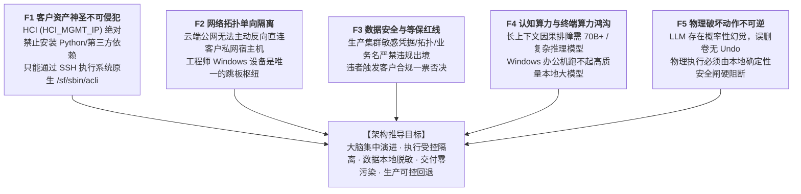
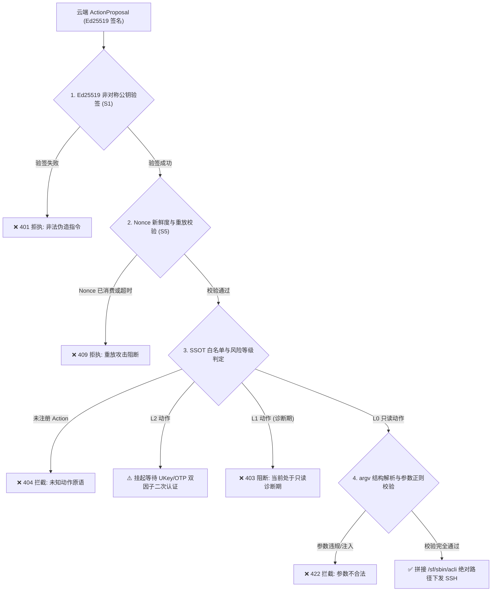
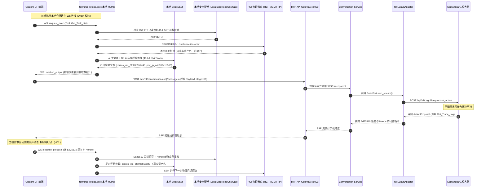

# HCI 认知排障智能体 · 本体驱动云边端协同架构设计与实施规范

> [!NOTE]
> **历史归档声明（2026-11-09 归档）**
>
> 本文是 2026-10-10 定稿的 **v1.3.0 顶层架构决议记录**，描述当时的目标态设计，**不代表当前实现状态**，仅用于追溯当时为何做出这些决策。
>
> 可复核的失效依据：
> - 文中写死的机器可读 SSOT 版本 **3.2.0**（25 类对象 / 40 条链路 / 18 个受控动作）与上游契约版本 **2.2.0**，实测已分别演进到 `semantica` 仓库的 `ontology_schema.json` **4.1.0** 与 `ontology_architecture.md` **2.3.0**；
> - 文中作为跨仓接入点的 `OTLBrainAdapter` 在 `hci-troubleshoot-platform` 代码中并未落地，相关概念只见于 `semantica` 的设计文档；
> - 文中引用为审计台账的 `architecture_full_review.md`、`ontology_agent_architecture_review.md`、`ontology_agent_architecture_review_1.md` 在两个仓库中均已不存在，证据链不完整。
>
> 现行契约一律以当前仓库内的 SSOT 文件与代码为准，不得依据本文实施。

| 项 | 值 |
| :--- | :--- |
| 版本 | 1.3.0 (双审查穿透全闭环与 SSOT 契约严密对齐版) |
| 文档层级 | **顶层架构与实施规范层**——定义两仓分工、战略决议、云边端协同拓扑、安全防线与接口契约 |
| 上游契约 | `docs/domain/ontology_architecture.md`（版本 **2.2.0**，不变量 INV-1～INV-6 与 ADR 所在） |
| 机器可读 SSOT | `data/schema/ontology_schema.json`（版本 **3.2.0**，25类对象、40条链路、18个受控动作） |
| 关联实现 | `tools/agent/hci_troubleshooting_agent.py`（原型）· `tools/agent/entity_vault.py`（规约）· `tools/agent/causal_reasoner.py`（骨架） |
| 跨仓接入适配器 | `OTLBrainAdapter`（HTP `backend/agent-service` 接入 Semantica 的六边形适配器） |

> **方法论声明**：本文严格基于**第一性原理（First Principles）**推导底层硬约束，并全面吸收《对抗性评审报告》与《对抗性审查归档》（C1–C5, S1–S6, D1–D7, AR-P0-01~08）全部审查意见，彻底清除虚假闭环、语义劫持与安全威胁漏洞。

---

## 1. 第一性原理问题解构：五个不可动摇的物理事实

在 Sangfor HCI 生产排障场景中，存在五大不可动摇的物理铁律：



1. **F1 客户环境纯净性**：HCI 节点承载关键业务虚拟机，研发无权变更生产环境依赖，排障只能使用系统原生的只读 CLI；
2. **F2 网络路由单向性**：云端服务器位于公网或中心机房，客户机房处于多重防火墙、NAT 保护下，云端物理上无法主动建连客户宿主机；
3. **F3 客户数据合规红线**：底层系统日志包含业务虚拟机名、内部拓扑 IP 等，必须具备面向强等保客户的零信任脱敏能力；
4. **F4 认知算力壁垒**：精准白盒排障需要分析上万字 Go 调度堆栈并结合案例图谱，必须依赖中心化高性能推理集群；
5. **F5 动作不可逆性**：LLM 是概率性系统，若直接赋予其执行权限，一旦发生参数幻觉将导致生产灾难。

---

## 2. 候选架构对抗性红队走查（Adversarial Review）

| 评估维度 | 模式 1（全量在 Windows 端） | 模式 2（全量在云端 + 反向 SSH Bridge） | **模式 3（云边端协同 · 推荐最优解）** |
| :--- | :--- | :--- | :--- |
| **拓扑关系** | `云端 Semantica` --HTTPS-- `Agent+LLM(Windows)` --SSH-- `HCI` | `云端 Semantica+Agent+LLM` --HTTPS-- `Web+Bridge(Windows)` --SSH-- `HCI` | **`云端无状态认知大脑` <--单向HTTPS--> `Windows绿色探针` <--SSH--> `HCI`** |
| **NAT 穿透与网络风险** | Windows 主动出网，无穿透阻碍 | **致命死穴！💥** 云端无法直连内网 Windows，必须建立反向隧道（FRP），**被 EDR 判定为木马反弹拦截** | **标准 Web 协议**：Windows 单向主动请求云端，天然穿透一切防火墙 |
| **数据等保合规** | 较好，日志留在本地 | **致命死穴！💥** 原始明文系统日志直接出境，强等保客户一票否决 | **双轨演进**：一般客户 TLS 1.3 传输加密，强等保客户本地内存级可逆脱敏 |
| **推理质量与因果精度** | **极差**：受限于 PC 硬件，只能跑本地小模型，频繁截断幻觉 | **极强**：调用云端高性能推理集群 | **极强**：云端高性能模型 + 6000+ 案例图谱拓扑剪枝 |
| **客户端交付与维护** | **维护地狱**：几十名工程师电脑需配 Python、CUDA，环境冲突严重 | **极轻**：仅需打开 Web 浏览器 | **极轻**：单二进制免安装绿色探针（<2.5MB），双击即用 |
| **物理安全防线** | 分散在各客户端，逻辑易腐化 | 依赖云端决策，本地 Bridge 是盲执行哑终端 | **双重安全闸**：云端 SSOT 参数校验 + 本地探针严格受控拦截 |

---

## 3. 顶层战略级决策与危机化解（STRATEGIC-01 ~ STRATEGIC-08 终局决议）

针对此前架构审查中暴露出的“认知/身份/战略三重危机”，确立如下架构定调：

### 3.1 [STRATEGIC-01] Semantica 的战略定位：无状态认知微服务模式
- **决议定调**：**Semantica 的本质角色是「本体知识中枢与因果推理内核」（SSOT & Cognition Kernel）**。在部署形态上，确定采用**独立无状态认知微服务（Stateless Cognitive Microservice）**；
- **边界划分与状态解耦（D4 澄清）**：
  - **会话与执行层完全无状态**：Semantica 自身**不持有 WebSocket 连接、不持久化会话 Session、不管理工单状态（Case 6态）、不直连任何物理主机 SSH**；
  - **本体知识层持久有状态**：TBox 元模型、ABox 案例图谱与因果转移概率矩阵持久化存储于后端图存储（Neo4j/Oxigraph）中；
  - 核心对外 API 契约：
    - `POST /api/v1/cognitive/propose_action`：输入观测与实体上下文，返回 Top-K 假设与推荐排障动作；
    - `POST /api/v1/cognitive/verify_hypothesis`：输入假设与验证证据，返回后验置信度；
    - `GET /api/v1/ontology/schema`：只读暴露 `semantica` 仓库的 `data/schema/ontology_schema.json`（文中登记的版本 **3.2.0**，现已演进为 4.1.0）。

### 3.2 [STRATEGIC-02] 两仓职责稳定性切割矩阵与组织分工
- **决议定调**：按**职责稳定性与演进周期切割**：
  1. **平台与业务工程（最稳定）** ➔ `hci-troubleshoot-platform`：负责工单生命周期、S0-S6 会话状态机、Go 语言 SSH 终端管道、Vue3 控制台以及安全审计日志；
  2. **推理与算法核心（中等稳定性）** ➔ `semantica`：负责本体论元模型（TBox/ABox）、因果推理算法、拓扑假设剪枝以及标准安全状态机算法规约；
  3. **领域知识与案例资产（演进最频繁）** ➔ **Schema 声明式解耦**：HCI 案例知识库和告警字典以标准 JSON/TTL 形式沉淀在 Semantica 的知识库中，HTP 通过只读接口与 CI 门禁消费。

### 3.3 [STRATEGIC-03] Pearl 因果 DAG 的真实工程路径与四阶段里程碑
- **客观事实声明**：系统坦诚承认**当前尚未实现完整的 Pearl 因果 DAG 动态推断**。代码库现有部分为 TBox 模式、告警字典与原型匹配。
- **演进路线图**：
  - **Milestone 1 (M1 · 当前执行阶段 · 2周)**：静态拓扑因果与常识图谱显式化。将受控 Action 与 acli 命令、日志路径强绑定；KBD 案例挂载为静态 `Symptom -[INDICATES]-> RootCauseHypothesis`；LLM 在 Ontology 上下文内启发式剪枝；
  - **Milestone 2 (M2 · 4周)**：贝叶斯信念网络（BBN）。基于 6000+ 历史案例共现矩阵计算先验概率 $P(H)$ 与似然度 $P(E|H)$，实现后验概率动态更新与数学剪枝；
  - **Milestone 3 (M3 · 6周)**：Pearl do-calculus 介入推理与最小测试代价规划。引入信息增益算法，推荐单步信息量最大且系统开销最小的只读 Action；
  - **Milestone 4 (M4 · 远期演进)**：反事实因果推断与工单闭环自演进。排障成功案例自动沉淀回写 ABox 图谱（脱敏回写）。

### 3.4 [STRATEGIC-04] 语义保留型脱敏（Semantic-Preserving Masking）与因果同构性修正
- **理论纠偏**：单纯将实体置换为无意义符号（如 `vm_01`）会导致大模型预训练领域先验知识丢失、案例模式库向量检索失效以及多实体业务关联断裂；
- **修正方案**：采用**语义保留型脱敏**：
  - 剔除真实主机名与 IP，但保留**架构与操作系统语义类型**（如 `sample_vm_mem` ➔ `centos_vm_{hash:12}`，`HCI_MGMT_IP` ➔ `priv_ip_node_{hash:12}`）；
  - 既满足等保对具体资产真名不出网的要求，又完全保留大模型对“CentOS 高内存配置调度特性”的预训练推理能力。

### 3.5 [STRATEGIC-05] HTP 现有成熟体系与 Semantica 增量价值的平滑融合
- **决议定调**：**严禁用未成熟的 Semantica 粗暴替代 HTP 已验证的生产链路**。
- **落地形态**：
  - HTP 现存成熟的 S0-S6 状态机、KBD 混合检索和 ReAct 引擎保持为主干基座；
  - Semantica 作为六边形适配器 `OTLBrainAdapter` 挂载到 HTP `agent-service` 中，作为**高阶因果剪枝插件**；
  - 支持会话级灰度配置：优先尝试 OTL 因果剪枝，若服务不可达或无匹配因果链，无感熔断降级回 HTP 原生 ReAct 链路。

### 3.6 [STRATEGIC-06] 跨仓 Schema 版本治理机制与防漂移门禁
- **版本控制契约（C5 对齐）**：
  - `ontology_schema.json` 真实版本号为 **3.2.0**，动作总数为 **18 个**（包含 13 个 L0 只读、4 个 L1 局部修复、1 个 L2 破坏动作）；
  - 任何 Action 参数名、枚举值的变更均视为 Breaking Change，主版本号递增；
- **跨仓 CI 门禁**：
  - HTP 的 CI 流水线引入 `schema-sync-check` 任务，自动拉取 Semantica 最新 Schema 进行契约兼容性测试；
  - 边缘端 `terminal_bridge` 每次建连时比对本地 ToolCatalog 快照与云端的 Schema Hash，哈希不一致时自动告警并触发安全更新。

### 3.7 [STRATEGIC-07] 生产排障智能体控制基线：可审计、可中止、可回滚 (HITL)
生产环境排障坚决执行工业级安全三原则：
1. **动作 Dry-Run 与人机协同确认（HITL）**：所有云端生成的 `ActionProposal` 默认以卡片形式呈现在前端，必须由现场技术支持工程师确认后才由 Bridge 物理执行；
2. **一键干预中止（Interrupt）**：工程师可随时按下终端控制台的“中止”按钮，前端向 Bridge 发送取消信号，Bridge 立即向当前 SSH 进程发送 `SIGINT` 并阻断 ReAct 循环，保持 SSH 会话存活；
3. **步骤级回溯与重放（Trace Replay）**：全链路记录 Thought-Action-Observation 完整元数据并绑定独立生成的 UUID，支持排障步骤回退与故障复盘。

### 3.8 [STRATEGIC-08] 云边协同端到端延迟约束量化分析与分级响应 SLA
- **延迟量化模型**：单步 ReAct 总耗时 = 边缘 SSH 执行 (0.5~2s) + 本地脱敏 (<10ms) + 上行网络 RTT (50~150ms) + 云端模型推理 (3~15s) + 下发与反向还原 (50~100ms) $\approx$ **4s ~ 18s / 步**。
- **分级响应 SLA 机制（D6 解决）**：
  - **严重阻塞级故障（P0/P1）**：启用“快速规则路径（Fast-Path）”，直接触发由云端签名分发的动态规则快照（<1s/步），跳过云端长上下文大模型；
  - **疑难分析级故障（P2/P3）**：启用“因果大脑路径（Cognitive-Path）”，通过云端 Semantica 大模型进行深度白盒分析；
  - **流式并发打字机**：云端 Thought 思考过程通过 SSE 实时推流前端，消除工程师等待焦虑。

---

## 4. 两仓分工与拓扑架构（BUG-01 纠偏）

系统明确划分为两个协作代码仓库，形成**“无状态认知内核 (Brain)”与“运行平台/执行受控体 (Body)”**的共生关系：

```mermaid
graph TB
    subgraph RepoSemantica ["代码仓库：semantica (高阶认知智能与本体因果内核)"]
        OntologySSOT["TBox/ABox 本体论元模型 (v3.2.0)<br/>(ontology_schema.json / domain_ontology.ttl)"]
        CausalEngine["Pearl 因果推理引擎内核<br/>(CausalReasoner / 拓扑剪枝骨架)"]
        SafetySpec["INV-2 能力授权分离与安全规约<br/>(AST 白名单 / JSON Schema 契约)"]
        VaultSpec["EntityVault 算法规约与参考实现<br/>(语义保留脱敏规范 / 48-bit HMAC)"]
        KGPipeline["案例知识工程 Pipeline<br/>(6000+ 案例图谱抽取 / ABox 实例构建)"]
    end

    subgraph RepoHTP ["代码仓库：hci-troubleshoot-platform (业务运行底座与执行基础设施)"]
        subgraph HTPBackend ["后端服务集群 (FastAPI / K3s)"]
            APIGW["api-gateway (:8000)<br/>OTel Span / W3C Trace / 限流"]
            CaseSvc["case-service (:8001)<br/>工单 6 态生命周期"]
            CvsSvc["conversation-service (:8002)<br/>S0-S6 状态机 / SSE 队列"]
            AgentSvc["agent-service (:8005)<br/>BrainRouter 分发器"]
            OTLAdapter["★ OTLBrainAdapter<br/>(Ports & Adapters 六边形适配器)"]
            KBSvc["kb-service (:8004)<br/>KBD / BM25+pgvector 混合检索"]
        end

        subgraph HTPClient ["边缘执行通道与客户端 (Windows 本地环境)"]
            Bridge["★ terminal_bridge (Go 单二进制 2.5MB :9999)<br/>免密 SSH / PTY / Marker 包裹"]
            LocalVault["★ 本地运行时 EntityVault<br/>(Go 内存级流式/批量脱敏拦截器)"]
            LocalGate["★ 本地运行时 LocalDiagReadOnlyGate<br/>(Go 原生 AST 白名单校验 / 诊断期安全 Overlay)"]
            CustUI["frontend/customer (Vue3/Vite :pnpm)<br/>终端控制台 / 交互卡片 / 握手向导"]
        end
    end

    %% 跨仓协作连接
    OntologySSOT -->|Schema 契约与 ToolCatalog| OTLAdapter
    OntologySSOT -.->|编译生成本地规则缓存| LocalGate
    SafetySpec -.->|Go 代码移植基线| LocalGate
    VaultSpec -.->|Go 代码移植基线| LocalVault
    CausalEngine -->|无状态 HTTP REST 认知接口| OTLAdapter
    
    AgentSvc --> OTLAdapter
    CvsSvc --> AgentSvc
    APIGW --> CvsSvc
    CustUI <-->|WebSocket: 9999 (带本地令牌)| Bridge
    CustUI <-->|HTTPS / WSS| APIGW
    Bridge --> LocalVault
    LocalVault --> LocalGate
```

### 4.1 两仓详细职责与物理边界分工矩阵

| 维度 / 模块 | 算法定义与规约源 | 物理运行驻留地 (Runtime) | 具体物理路径 / 宿主环境 | 核心定位与技术实现 |
| :--- | :---: | :---: | :--- | :--- |
| **世界模型 (TBox/ABox)** | `semantica` | 云端 (无状态微服务) | `data/schema/ontology_schema.json`<br/>`data/schema/domain_ontology.ttl` | 形式化本体论单一事实源（SSOT v3.2.0）。定义 25 类对象、40 条链路、18 个受控动作元模型。 |
| **因果推理内核** | `semantica` | 云端 (无状态微服务) | `tools/agent/causal_reasoner.py` | 基于 Pearl 因果图与贝叶斯信念网络。计算 $P(\text{RootCause}\mid\text{Evidence})$，执行拓扑剪枝。 |
| **脱敏算法规约** | `semantica` | 研发测试态 | `tools/agent/entity_vault.py` | 纯内存双向可逆脱敏规约：语义保留、48-bit 加盐 HMAC、会话碰撞重散列。 |
| **★ 实体脱敏运行引擎** | `hci-troubleshoot-platform` | **边缘端 (Windows 内存)** | `terminal_bridge/filter/entity_vault.go` | **必须驻留本地！(BUG-01/02 纠偏)** 在原始 SSH 数据离开本地前完成脱敏，物理阻断明文出网。 |
| **★ 边缘诊断安全硬闸** | `hci-troubleshoot-platform` | **边缘端 (Windows 内存)** | `terminal_bridge/safety/gate.go` | **必须驻留本地！(C1/SEC-01 纠偏)** 本地 AST 强校验，实现 `LocalDiagReadOnlyGate` 诊断期只读与参数白名单。 |
| **AI 调度适配器** | `hci-troubleshoot-platform` | 服务端集群 | `backend/agent-service/app/adapters/`<br/>`otl_brain_adapter.py` | 实现 HTP 六边形架构 `BrainPort`，将脱敏会话上下文转换为 Semantica 认知请求。 |
| **工单业务状态机** | `hci-troubleshoot-platform` | 服务端集群 | `backend/case-service/` (:8001) | 负责工单 6 态业务合同层（`created` → `confirmed` → `resolved` → `closed`）。 |
| **诊断会话状态机** | `hci-troubleshoot-platform` | 服务端集群 | `backend/conversation-service/` (:8002) | 统一驱动 S0-S6 AI 诊断阶段流转、维护 SSE 打字机流、调度非阻塞 `merge_queue`。 |
| **SSH 执行管道** | `hci-troubleshoot-platform` | 边缘端 (Windows) | `terminal_bridge/` (Go 源码)<br/>单文件可执行程序 (2.5MB) | 监听 `127.0.0.1:9999`，提供伪终端 PTY、Marker 命令包裹执行、退出码捕获与桌面日志。 |
| **交互前台 (UI)** | `hci-troubleshoot-platform` | 边缘端 (浏览器) | `frontend/customer/` (Vue3+pnpm) | 运维工程师操作门户。Xterm.js 终端、SSH 握手向导、HITL 确认卡片及会话交互。 |
| **全链路可观测性** | `hci-troubleshoot-platform` | 服务端集群 | `backend/shared/observability/` | 全链路 W3C `traceparent` 生成与透传、OTel Span、PostgreSQL 全表 `trace_id` 契约。 |

---

## 5. 六边形架构集成与上下文管理（BUG-04, OPT-04）

### 5.1 上下文合并与双适配器无损切换机制（BUG-04 解决）
针对双适配器（`HTPBrainAdapter` 与 `OTLBrainAdapter`）并存的场景，确立如下治理机制：
1. **单一真理源原则**：**所有排障历史上下文（ReAct 轮次、S0-S6 阶段、工单事实）唯一持久化在 HTP 的 `conversation-service` 中**。任何适配器均不得私自维护持久状态；
2. **上下文标准化注入**：当 `BrainRouter` 调用 `OTLBrainAdapter` 时，从 `conversation-service` 拉取完整历史列表，组装成标准 `CognitiveContextPayload` 发送给 Semantica；
3. **无缝平滑迁移**：若从 OTLBrain 降级切换为 HTPBrain，由于上下文由平台统一持有，直接将历史轮次喂给默认 LLM 即可，零记忆断裂；
4. **SSE 输出原子队列**：流式推送由 `conversation-service` 的 `merge_queue` 统一调度，各适配器的 chunk 经由带有 `step_index` 的事件包严格保序推流。

### 5.2 熔断降级架构（S6, OPT-04 纠偏）
- `OTLBrainAdapter` 配置熔断器（Circuit Breaker）：
  - **超时阈值设为 25s（S6 纠偏）**：充分容纳大模型深度推理（3~15s）与网络 RTT，避免 8s 错误截断；
  - **连续失败 3 次触发熔断**；
  - 或采用**首包存活探测（TTFT Probe）**：首字节在 8s 内返回即视为健康，重置空闲计时器；
- 触发熔断后，自动回退到 `HTPBrainAdapter`（基于 HTP 原生 ReAct + KBD 混合检索）；
- Semantica 暴露 `/healthz` 端点，供平台进行健康探测与自动恢复。

---

## 6. 边缘端 EntityVault 规范与安全加固（BUG-02, S2, S3, DESIGN-01, D7）

### 6.1 物理阻断脱敏时机：Go 探针层截断（BUG-02 纠偏）
> [!IMPORTANT]
> **绝对禁止在前端浏览器 JavaScript 中执行核心脱敏**！  
> 脱敏必须在 Go 语言编写的 `terminal_bridge` 内部、向 WebSocket 写入数据前完成。

- **批量命令模式（Marker 包裹）**：在 `drainExecPipeFiltered` 捕获到完整输出后，整段传入 `EntityVault.MaskText()`，脱敏后的文本再包装成 `ssh_output` 发送；
- **交互终端模式（PTY 实时流）**：作为 `terminal_bridge` 现有的 `OutputFilter` 插件（`OPT-02`），以行级滑动窗口处理字符流，确保流式日志同样无敏感词泄露。

### 6.2 Token 安全加固：加长 48-bit 散列与碰撞重散列（S2 纠偏）
为彻底消除生日悖论碰撞，Token 生成算法采用加长熵空间与确定性重散列：
$$\text{Token} = \text{TypePrefix} + \text{"\_"} + \text{HMAC-SHA256}(\text{Secret}, \text{SessionID} + \text{Type} + \text{RealVal} + \text{Counter})[:12]$$
- 12 位十六进制 = 48 bit 空间。在 $n = 10^4$ 实体规模下，碰撞概率 $P \approx 1 - e^{-\frac{10^8}{2 \times 2^{48}}} \approx 1.7 \times 10^{-7}$，数学上可忽略；
- 本地维护已分配集合，发生碰撞自动自增 `Counter` 重新散列。

### 6.3 存储与密钥托管自洽性（S3 纠偏）
- **纯内存优先原则**：正常运行期间，映射表仅驻留于 `terminal_bridge` 进程私有内存，进程退出即自动安全擦除（Secure Wipe），确保“本地不留存”；
- **断线恢复可选降级**：若需开启断线恢复，快照在本地使用 Windows DPAPI（绑定当前用户凭据）加密保存，设置 30 分钟硬 TTL，严禁明文落盘。

### 6.4 标识体系解耦（D7 解决）
明确分离正交关注点的三大标识符：
1. **`trace_id`**：32-hex 字符串，严格用于 W3C 分布式追踪与可观测性；
2. **`session_id`**：终端通信会话标识，驱动 EntityVault 内存隔离；
3. **`incident_id`**：知识图谱中的排障事件唯一身份，必须为**合规的标准 UUID**（如 `550e8400-e29b-41d4-a716-446655440000`）。

---

## 7. 本地边缘端命令校验与安全防线（C1, C2, S1, S4, S5, D2）

### 7.1 不变量正名与安全分级（C1, C2 纠偏）
- **INV-2 正名（C1 纠偏）**：根据 SSOT，`INV-2_capability_authorization_separation` 的真实含义是“`DiagnosticProcedure` 描述能力，`action_types` 授予执行权；禁止由前者推导后者”。
- **LocalDiagReadOnlyGate（场景化只读 Overlay，C2 纠偏）**：
  - SSOT 定义了完整的 L0（只读）、L1（局部非破坏修复）、L2（破坏动作双因子）三级风险模型；
  - 边缘端安全闸完整支持三级判定：
    - `Risk_Level_0`：静默放行；
    - `Risk_Level_1`：单事件限流 2 次，需 HITL 确认；
    - `Risk_Level_2`：管道强制挂起，必须由审计管理员输入 UKey/OTP 双因子放行；
  - 在“现场排障诊断期”，默认挂载 `LocalDiagReadOnlyGate`（仅放行 L0 只读动作），杜绝诊断阶段发生误修改。

### 7.2 命令构造与路径归一化规范（D2, AR-P0-01 纠偏）
为彻底解决 SSOT 裸模板 `acli ...` 与物理绝对路径 `/sf/sbin/acli` 的冲突，制定标准处理顺序：
1. **模板实例化**：根据 SSOT `execution_template` 填充参数，生成命令原语；
2. **绝对路径归一化**：边缘探针检查命令字，依据本地只读配置将开头的 `acli` 替换为绝对路径 `/sf/sbin/acli`；
3. **AST 结构化解析（AR-P0-03 防御）**：探针将命令词法解析为 **`argv` 数组**，禁止直接通过底层 shell 拼接字符串执行；
4. **参数白名单与正则校验**：参数必须严格命中 SSOT 中声明的类型、枚举或正则，拒绝任何自由文本逃逸。



### 7.3 通信安全与本地防护（S1, S4, S5）
1. **非对称 Ed25519 数字签名（S1 纠偏）**：云端 KMS 持有私钥对 `ActionProposal` 进行签名，边缘二进制仅内置公钥验签。即使边缘二进制被反编译，攻击者也无法伪造签名；
2. **Localhost WebSocket 鉴权与 Origin 白名单（S4 纠偏）**：
   - Bridge 强制校验 `Origin` 请求头，严格限制为 HTP 控制台白名单；
   - Bridge 启动时生成一次性本地握手令牌（Local Handshake Token），前端建连必须携带，彻底封堵跨源恶意页面 CSRF/DNS-Rebinding 攻击；
3. **Nonce 与防重放机制（S5 纠偏）**：`ActionProposal` 注入服务端签发的一次性 `nonce` 与短时效 `expires_at`，Bridge 消费后记入去重布隆表。

---

## 8. 单向通信时序与通信协议安全（BUG-02, S1, S4, S5, DESIGN-05）

纠偏后的端到端完整时序图如下：



### 8.1 通信协议安全强化（S1, S5, DESIGN-05）

#### 1. 前端 ➔ 后端：`ObservationPayload`（阶段枚举对齐 HTP S0~S6，包含 date/context 定位参数）
```json
{
  "session_id": "sess_89f0a1c3e4b7",
  "trace_id": "0eb53fa762f140ffa7f11079dd9498aa",
  "incident_id": "550e8400-e29b-41d4-a716-446655440000",
  "step_index": 2,
  "diagnostic_stage": "S3",
  "masked_observation": {
    "tool_name": "Get_Trace_Log",
    "invoked_arguments": {
      "request_id": "ac85aa23c1fb0d9e32da271804d34f06",
      "date": "2026-10-09",
      "context": 2
    },
    "exit_code": 0,
    "stdout": "/sf/log/9/vt/scheduler.log:2026-10-09 err [scheduler] sched.go:1172 schedule pod vmid_01/centos_vm_6fb09c557d43 error: 没有主机能够启动虚拟机 ... vm spec: {VMName:centos_vm_6fb09c557d43 Memory:131072}"
  }
}
```

#### 2. 云端 ➔ 边缘端：`ActionProposal`（包含 Ed25519 非对称签名与防重放 Nonce）
```json
{
  "session_id": "sess_89f0a1c3e4b7",
  "trace_id": "0eb53fa762f140ffa7f11079dd9498aa",
  "step_index": 3,
  "nonce": "a7e93f1c8b2d4e60",
  "expires_at": 1791535200,
  "thought": "调度器日志确凿证实因 Memory: 131072 拒绝调度，接下来需巡检全集群可用内存水位印证根因。",
  "proposed_action": {
    "tool_name": "List_Nodes",
    "risk_level": "Risk_Level_0",
    "masked_arguments": {}
  },
  "signature": "ed25519_sig_d83fa9b12c7e094f...",
  "is_final": false
}
```

---

## 9. KBD 案例库隐式知识破局与知识融合机制（DESIGN-02, SEC-05, OPT-05）

### 9.1 KBD 隐式常识断裂分析与 Ontology 显式化
- **痛点本质**：KBD 案例库是“人写给人看的”，严重缺失 HCI 系统底层常识（日志文件具体路径、模块与报错的拓扑关系、`acli` 命令原语与参数）；
- **Palantir Ontology 破局**：
  - TBox 元模型显式定义实体（Cluster/Host/VM/Storage）、观测（TelemetryMetric/LogSignature）与受控动作；
  - KBD 案例不再被当成自由文本，而是通过提取实体映射为 ABox 中的结构化事实与因果关系实例。

### 9.2 因果 DAG 与 KBD 检索的决策融合与仲裁（DESIGN-02）
当 HTP 的 `kb-service`（BM25+向量检索）与 Semantica 的因果 DAG 协同工作时，确立如下融合机制：
1. **KBD 检索作为先验概率输入**：KBD 匹配到的相似案例，其置信度作为贝叶斯因果网络中候选假设的初始先验概率 $P(H)$；
2. **因果 DAG 作为拓扑物理剪枝器**：若 KBD 推荐了某个原因，但当前集群物理拓扑并不满足其前置条件，因果 DAG 拥有**一票否决权**，直接将该假设剪枝；
3. **决策冲突仲裁**：**物理拓扑与安全规范优先于历史统计案例**。

### 9.3 ABox 知识序列化安全加固（SEC-05, OPT-05）
- 弃用字符串拼接构造 RDF/Turtle 的不安全做法；
- 全面采用 `rdflib` 类型安全 API 构建 `Graph` 对象并序列化，消除 Turtle 注入漏洞，并保证知识回写的语法正确性。

---

## 10. 客户数据合规双轨演进策略（实用主义 vs. 护城河）

结合真实业务交付情况，确立**“业务敏捷走通第一，技术护城河标准先行”**的双轨策略：

| 维度 | 轨一：当前敏捷模式（一般企业客户） | 轨二：强等保模式（金融/政企客户护城河） |
| :--- | :--- | :--- |
| **客户画像** | 现阶段真实企业客户，允许安全通道下数据上云 | 金融、军工、核心政企，要求数据零明文出境 |
| **网络信道** | Windows 客户端单向主动发起 TLS 1.3 HTTPS/WSS | 相同单向安全信道 |
| **脱敏策略** | 基础脱敏（仅过滤密码、密钥等极端敏感词） | **完整 EntityVault**（资产名、IP、卷名全置换为语义保留 48-bit Token） |
| **执行开销** | 本地性能开销零增加，业务闭环快速打通 | 毫秒级内存正则替换与反向还原 |
| **交付准备** | **当前立即生效执行** | **核心算法与接口全量就绪，配置一键激活** |

---

## 11. 现场运维交付与实施规程

### 11.1 客户端绿色交付物构建
边缘端探针采用纯轻量技术栈（Go 语言编译的 `terminal_bridge.exe`）：
- **产物形态**：单个独立文件 `terminal_bridge.exe`（大小约 2.5 MB）；
- **运行环境要求**：支持 Windows 10/11/Server 任意版本，**无需安装 Python、无需配置 Node、无需管理员提权**；
- **清理机制**：程序退出时，自动清空内存中的映射表，本地不留存任何涉密业务数据。

### 11.2 工程师标准现场排障操作
1. 技术支持工程师在客户现场 Windows 笔记本打开并运行：
   ```cmd
   terminal_bridge_x86.exe
   ```
2. 浏览器打开 HTP 控制台页面，在 SSH 向导中输入目标宿主机 IP `HCI_MGMT_IP` 与认证凭据；
3. 平台后台自动挂载 `OTLBrainAdapter`，向 Semantica 无状态认知微服务发起推理请求；
4. 交互界面展示推荐探查动作（Dry-Run 卡片），工程师审阅确认后下发，后台自动推进因果假设验证，最终输出权威诊断报告与修复 SOP。

---

## 12. 架构版本演进与修订历史（Revision History）

| 版本 | 日期 | 修订摘要 | 关键变更内容与安全加固说明 | 审计台账归档 |
| :--- | :---: | :--- | :--- | :--- |
| **v1.0.0** | 2026-10-09 | 初始草案 | 确立模式 3 云边端协同排障基本拓扑。 | — |
| **v1.1.0** | 2026-10-09 | 结构对齐 | 明确两仓分工边界，新增 `OTLBrainAdapter` 六边形接口定义。 | `architecture_full_review.md` |
| **v1.2.0** | 2026-10-09 | 战略决议重构 | 明确 STRATEGIC-01~08 决议，Semantica 定位为无状态认知微服务。 | `architecture_full_review.md` |
| **v1.3.0** | 2026-10-10 | 全量对抗性加固与 SSOT 严密对齐 | 1. 恢复 `INV-2` 为能力授权分离，另立 `LocalDiagReadOnlyGate` 策略；<br/>2. 升级非对称 Ed25519 签名与一次性 Nonce 防重放；<br/>3. Token 扩展至 48-bit 消除碰撞，完善纯内存安全；<br/>4. 全量对齐 SSOT v3.2.0 契约与 18 个 Action 清单；<br/>5. 确立 argv 数组命令解析与绝对路径归一化流水线；<br/>6. 补齐 `Get_Trace_Log` 的 `date`/`context` 定位参数与代码动态超时。 | `ontology_agent_architecture_review.md`<br/>`ontology_agent_architecture_review_1.md` |

> **文档层级与审计声明**：根据系统架构文档治理标准，本文档为**纯粹的系统规格与实施规范层（Normative Specification）**。有关上述变更项的历史攻击推演、形式化证明与逐项复核证据，完整归档于上述审计台账文档中。
