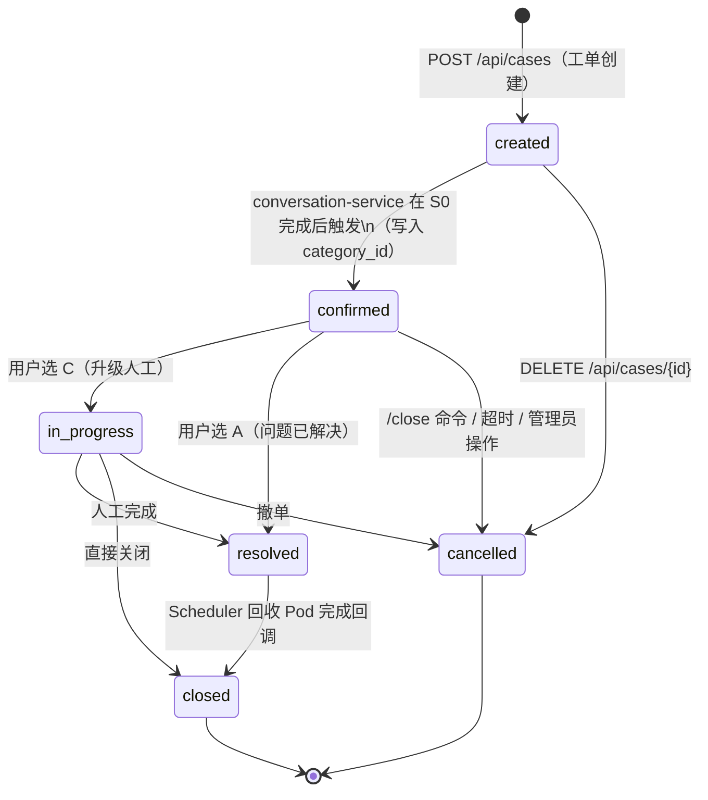
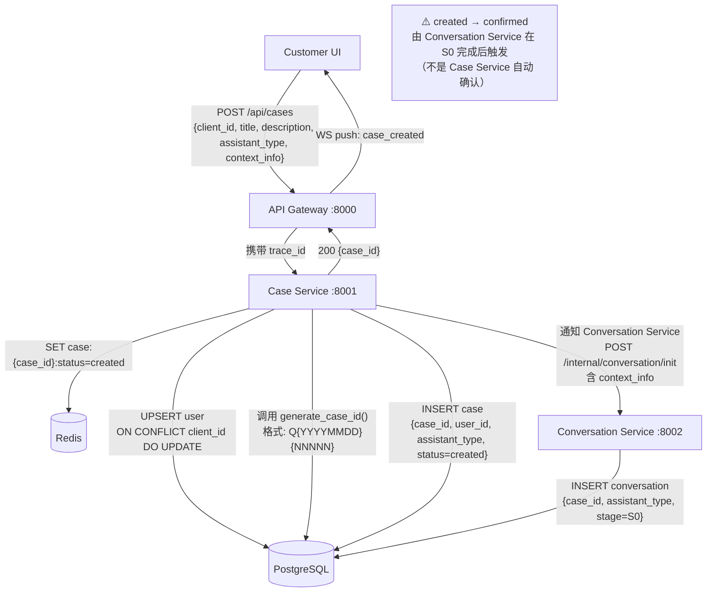
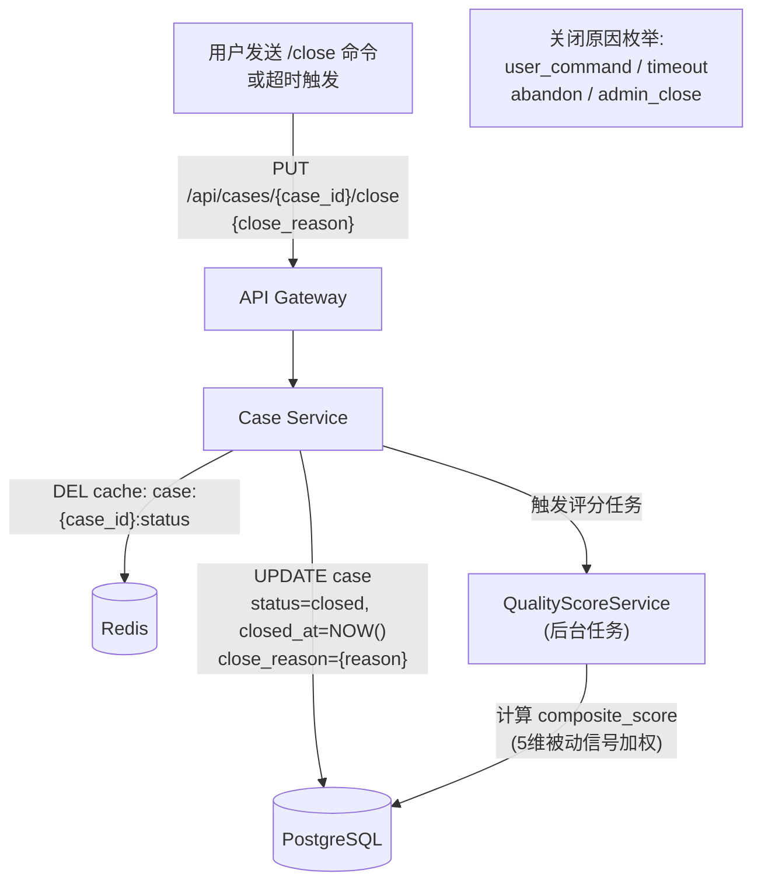

# Case Service — 设计文档

---
status: active
category: solution
audience: developer
last_updated: 2026-11-26
owner: team
---

## 变更历史

| 日期 | 版本 | 变更内容 | 关联事件文档 |
|------|------|---------|------------|
| 2026-11-26 | v3.18 | **日志收集修复残留收口**：客户任务列表/详情新增工单级只读条件 `case_archive_verified`（文案“本工单已有权威归档”），按 `archive_confirmation` / `p1_archive_check` / `delivery_evidence` 三类权威事实扫描同工单任务，不带 `created_by` 过滤、不改本任务结论；全部证据端点补记 `X-Bridge-Version`，消除 `detail.bridge_version` 空洞。 | [日志收集修复残留收口](../events/2026-11-26-日志收集修复残留收口.md) |
| 2026-11-26 | v3.17 | **日志收集场景能力门禁**：`create_task` 在建任务/算清单前校验 `payload.modules` 是否属于节点 acli help 真实枚举（`probe.catalog_source=acli_help` + `node_modules`）；不支持项返回 422 `LC-PLUGIN-016` 且不落任务。未带 probe 的直连请求用桥侧 30 分钟内最近一次 `log_collect.probe` 兜底；自定义 spc 场景按 `core` 槽位同规则校验。前端只展示节点支持的场景，历史回填自动移除并在表单提示。bridge 把「原件 stat 不到」归为 `spc_module_missing`（映射 `LC-PLUGIN-016`），不再混入 `LC-SPC-003`。 | [日志收集不支持场景不展示与建任务阻断](../events/2026-11-26-日志收集不支持场景不展示与建任务阻断.md) |
| 2026-11-24 | v3.16 | **日志收集包归属判定改为节点内相对时间**：`waitCollect` 不再用节点 mtime 与 bridge 墙钟比较，改为同一节点命令取 `date +%s` 与 `stat -c %Y` 做差，30 分钟时效内放行；`mtime` 晚于节点当前时间按时钟回拨放行并留证；旧包改为带 `LC-TRANSFER-011` 的 fatal 错误，主流程统一把 `deliveryErrorCode` 写入 `job.LastErrorCode`；契约文案改为只陈述节点本地时间与时效，保留旧关键词用于历史归因。 | [日志收集包归属时钟鲁棒性](../events/2026-11-24-日志收集包归属时钟鲁棒性.md) |
| 2026-11-18 | v3.15 | **acli 插件链路收口 v2.0：本服务退回期望态事实源 + 票据化只读数据面**：`app/routes/acli_plugins.py` 拆成三族互不共用依赖的路由（管理面 `/internal/acli-plugins/{templates,plugins,specs}` 走 `require_admin_token`；客户面 `/api/acli-plugins/ticket` 走 `get_client_id` + 工单存在性校验；同步面 `/internal/acli-plugins/{manifest,package/{plugin_name}}` **只认** `X-Plugin-Ticket`）；新增 `app/services/plugin_ticket.py`（HMAC-SHA256 从 `INTERNAL_API_TOKEN` 按 `acli-plugin-read` scope 派生，TTL 强制收敛到 `(0, ACLI_PLUGIN_TICKET_TTL_SECONDS=600]`，绑定 case，鉴权失败一律 401 且**先鉴权后读库**）；保存规格时把 `compile_descriptor` 产物固化进 `validation.compiled`，manifest 直出固化值，compiled 缺失才回退重算并留痕；删除部署命令计划与浏览器回执端点、后台 reconcile 协程与 ORM 模型。新增 24 例单测锁数据面契约。详见 [节点同步链路统一收口设计](../../plans/2026-11-18-节点同步链路统一收口设计.md) §3.3 / §D1。 | 收口设计 v2.0 |
| 2026-11-18 | v3.14 | **acli 插件下发 P0 止血**：部署脚本 `rollback()` 只在"有目录备份或 `.old.$DEPLOY_ID`"时才动现场目录，`lock_timeout`/`register_backup_failed` 这类发生在备份之前的失败不再删掉唯一副本（打 `ACP_ROLLBACK_SKIPPED=no_backup` 并保留现场）；脚本补 `INT/TERM/HUP` trap 收敛到回滚。发布幂等拆成 `in-flight`（`pending/claimed/running`，不比对 `current_spec_hash`）与 `succeeded 且 current_spec_hash 对齐`两段，首次未成功的重复提交不再重复排队；`POST /plugins` 新增 `force` 供节点被清空后重发同规格。 | — |
| 2026-11-16 | v3.13 | 修复 S7 残余两处缺陷：`artifact-manifest` 的五个 `:entries::jsonb`/`:evidence::jsonb` 改为 `CAST(... AS jsonb)`（原先被 asyncpg 原样执行导致 500）；`NetworkProbeIn.samples` 改为 `list[int]`，与 bridge 的 RTT 整型样本对齐（原先 422）。新增只读 `GET /{task_id}/host-results`，从桥日志回读桥端上报的逐台采集明细。 | [日志收集证据契约与逐台明细](../events/2026-11-16-日志收集证据契约与逐台明细.md) |
| 2026-11-18 | v3.13 | **插件下发执行权回归浏览器**：删除 `app/services/acli_plugin_bridge.py`（服务端 WS 客户端）与 `app/services/acli_plugin_relay.py`（租约轮询推送），`POST /internal/acli-plugins/plugins` 改为返回部署命令计划，新增 `POST /internal/acli-plugins/deployments/{id}/result` 接收浏览器回执并以设备侧 `ACP_RESULT` + `spec_hash` 判生效；管理台新增 `api/acliPluginBridge.ts` 直连桥（`list_sessions` / `ssh_exec_process`），不新建 SSH 连接、不接触凭据；同步删除 `ACLI_PLUGIN_*` 8 个环境变量、`caseServiceIngressEnabled` 入站放行与 `caseService.acliPlugin` values 段。 链路形态与 `acli_sync` / `log_collect` 一致。 | 设计文档 v1.4 |
| 2026-11-16 | v3.12 | 管理端日志收集任务列表/详情的 detail 白名单补回 `probe`/`create_ack`/`evidence_enabled`/`capabilities`：这些键是 `_build_stages()` 判定 S1/S2/S3/S7 的客观信号，此前被裁掉导致有探针的工单恒显「未知」。列表与详情共用同一白名单，避免二次分叉；结论与统计分桶保持不变。 | [日志收集详情可读性改造](../events/2026-11-16-日志收集详情可读性改造.md) |
| 2026-11-14 | v3.11 | 下发任务回显列显式化：`list_deployments` / `get_deployment` 不再 `SELECT *`，排除 `node_ip` 与 `lease_owner`，保证管理端页面既不能提交也读不到目标主机地址；新增单测锁死该契约。 | [acli 插件管理服务端编排重新设计](../events/2026-11-14-acli插件管理服务端编排重新设计.md) |
| 2026-11-14 | v3.10 | **管理端配置事实源闭环**：`app/services/acli_plugin_admin.py` 的 `prepare_publication` 校验规格并算出 `spec_hash`/`deploy_id`，`save_and_publish` 在同一事务写不可变 `acli_plugin_spec` revision、UPSERT `acli_plugin.desired_spec_hash` 并创建 `pending` 下发任务；同规格+环境已有进行中/已生效任务时幂等返回原 `deploy_id`。`app/routes/acli_plugins.py` 暴露模板/环境/插件列表/保存并下发/任务状态/历史（`/internal/*` + `require_admin_token`），`main.py` 注入并挂载；环境列表只回代号/名称/启用/认证方式，页面拿不到地址与凭据。新增 10 例单测，累计 67 例。 | [acli 插件管理服务端编排重新设计](../events/2026-11-14-acli插件管理服务端编排重新设计.md) |
| 2026-11-14 | v3.9 | **下发状态机接线**：`app/services/acli_plugin_relay.py` 用 `SELECT ... FOR UPDATE SKIP LOCKED` 条件 UPDATE 抢租约，覆盖 `pending` / 退避冷却后的 `failed` / 租约过期的 `claimed|running`；部署期间独立心跳续租；只有设备侧 `ACP_RESULT success` + 退出码 0 + 非空冒烟输出 + 回执 `spec_hash` 与任务一致才写 `succeeded` 并推进 `acli_plugin.current_spec_hash`，其余统一落结构化 `error_code` 与指数退避冷却。`app/main.py` 在 lifespan 起/停后台 `reconcile_loop`。新增 12 例单测，累计 57 例。 | [acli 插件管理服务端编排重新设计](../events/2026-11-14-acli插件管理服务端编排重新设计.md) |
| 2026-11-14 | v3.8 | **服务端主动连 bridge**：`app/services/acli_plugin_bridge.py` 用独立 WS 连接完成 `ssh_connect → ssh_connected → ssh_exec_process → exec_result`，凭据由 `ACLI_PLUGIN_CREDENTIALS_JSON`/Secret 挂载解析（口令只填去掉 `sangfornetwork` 后缀的前缀，bridge 自动补全），不落库/不写日志/不进异常文本；`resolve_bridge_url` 允许环境级覆盖（dev 指向可达 bridge），生产默认集群 Service。`websockets` 显式声明为直接依赖并同步 `uv.lock`（顺带修正基线缺失的 `zstandard` 锁记录）。新增 16 例单测覆盖协议顺序、凭据隔离与结构化失败码。 | [acli 插件管理服务端编排重新设计](../events/2026-11-14-acli插件管理服务端编排重新设计.md) |
| 2026-11-14 | v3.7 | **acli 插件管理服务端事实源（纯新增，不改既有工单链路）**：`app/domain/acli_plugin_spec.py` 收敛插件规格（禁止 `node_ip`/口令/私钥/bridge 地址进入规格）、校验 manifest 15 字段与 shell 安全、确定性生成 wrapper/逐文件 SHA-256/注册表项/`spec_hash`，用 `printf '%b'` 生成无 `base64`/`python3` 依赖的原子部署脚本并列为强制真实冒烟；`parse_deploy_result` 只认设备侧 `ACP_RESULT` + 非空冒烟输出，杜绝前端伪造成功。`app/models/acli_plugin.py` 新增四个 ORM 模型对齐四张新表。单测 29 例覆盖零凭据、内置插件覆盖、`bash -n`、哈希确定性与回执解析。 | [acli 插件管理服务端编排重新设计](../events/2026-11-14-acli插件管理服务端编排重新设计.md) |
| 2026-11-13 | v3.6 | 日志收集管理端详情/列表响应增加 `display` 派生字段（`scope`/`stages`/`fault_attribution`/`trace_id`），由 `contracts/log_collect_display.json` 单一事实源生成前后端常量，错误码→段/组件/阶段/客户文案/管理员判据的映射不再散落在前端。S1-S8 阶段去向查不到时一律 `unknown`，只有明确证据才判 `failed`；P1 归档核验等待期按有界窗口返回带时刻的 `pending`，窗口耗尽才转「未核验到」。改动触及 `backend/case-service/app/domain/log_collect_display.py`、`schemas/log_collect_display.py` 与生成物 | [日志收集三段五组件定界与首个异常点归因](../events/2026-11-13-日志收集三段五组件定界与首个异常点归因.md) |
| 2026-11-12 | v3.5 | 自定义场景请求/响应模型删除零消费的审核态与重复审计字段（`review_state`、`created_by`、`updated_by`、`created_at`、`updated_at`），对应列由迁移 060 物理删除。`update()` 生成新 revision 时不再从 Response 回填 `review_state` / `created_by`，避免删字段后 `AttributeError` 500；操作者仍由 `X-Admin-User` 写 `operation_audit` 与结构化日志，`revision` 版本化与任务引用契约不变。 | [自定义场景冗余配置收敛](../events/2026-11-12-自定义场景冗余配置收敛方案.md) |
| 2026-11-10 | v3.4 | 新增 `/internal/log-collect/admin/tasks` 只读端点：跨工单分页 + 汇总计数（P1/P2 分列），客户名复用 `case.customer_id → customer.name`（不新增列，`client_id` 单独返回）；`destination-progress` 代理按 P1 产物名 / P2 `relay_upload_id` 取 5888 真实进度，会话按代际绑定、404/超时一律降级且不写任务状态 | [日志上传管理页与进度代理](../events/2026-11-10-日志上传管理页与进度代理.md) |
| 2026-11-10 | v3.3 | P1 直传归档核验止血：`_judge_p1_archive` 体积判据由「必须相等」改为「不小于记录值」（`expected_size` 是平台侧观测峰值，会把完整归档误判成 `size_mismatch`）；`_p1_verify_patch` 只有强证据成立才写 `delivery_status=delivered`，否定观测只落 `detail.p1_archive_check` 核验快照、不再写 `failed`，已 delivered 的记录不被否定观测改写；前端横幅改为「平台尚未核验到归档件（时刻）」并新增只读「重新核验归档」；纠正现场工单号为 `Q2026111000243`（截图 OCR 曾多一个 0） | — |
| 2026-11-10 | v3.2 | 自定义场景 `Update` 接受 `source`（通道可纠正，此前建错通道只能改库）；`/validate` 响应增加 `preview_kind` 与 `preview_text`，返回服务端真实序列化文本，前端不再复刻协议。通道与条目不匹配（切回 `-c` 但残留 filters/通配符/非 copy 条目）返回 `ok=false` + `issues` 而非 500 | [管理端 spc 场景编辑器接入](../events/2026-11-10-管理端spc场景编辑器接入.md) |
| 2026-11-10 | v3.1 | 日志收集 spc 场景（节点本地清单 `core.json` 逐台覆写）落库：`log_collect_task` 增 `spc_slot`/`spc_sha256`/`spc_hosts`/`restore_status` 四列；PATCH 端点接受 bridge 回执补写逐台证据（`ip/backup/error`）。**还原态与采集状态正交**：`restore_status` 独立列、独立可查，不参与采集状态机（采集可能已 `completed` 而节点仍残留平台清单）。取值域 `none/pending/success/failed` 由请求与响应模型 `Literal` 双向限定，避免出现第二种"看似成功"的拼写；`spc_hosts` 设上限防任意体积 JSON 写入任务行 | [spc 扇出写入与生命周期恢复](../events/2026-11-10-spc扇出写入与生命周期恢复.md) |
| 2026-11-09 | v3.0 | 创建任务支持 `custom_scenario_id`：服务端按最新 revision 取场景、展开 `{date}`、合并 `extra_paths`，生成只含 `paths` 的配置原文与 SHA-256（**只在创建响应下发，平台不留副本**）；任务记录 `revision/config_sha256/path_count`，PATCH 支持 bridge 回执的 `config_path` 与 `preflight_missing` 落库。自定义场景与 `modules` 并存（config.modules 永不生效），场景已停用/不存在一律 422 | [日志收集自定义场景与额外路径](../events/2026-11-09-日志收集自定义场景与额外路径.md) |
| 2026-11-09 | v2.9 | 新增自定义场景（acli `-c`）端点：客户只读 `GET /api/log-collect/custom-scenarios`（只回元数据，items 不下发）；管理端 `/internal/log-collect/custom-scenarios` 提供 list/create/update/delete/validate。更新实现为「复制最新 revision + 1」，被历史任务引用的场景禁止物理删除（只能停用）；`log_collect_task` 记录 `custom_scenario_id`/`revision`/`config_path`/`config_sha256`/`path_count`/`preflight_missing` | [日志收集自定义场景与额外路径](../events/2026-11-09-日志收集自定义场景与额外路径.md) |
| 2026-11-03 | v2.8 | DSH 归档入库加固：① 只清洗结构内字符串再 `json.dumps`，禁止对序列化结果做字符串替换（会切断转义并生成非法 JSON）；② 每条会话独立 SAVEPOINT，单条被 PostgreSQL 拒绝不拖垮整批 | [工单证据聚合](../events/2026-11-02-工单证据聚合.md) |
| 2026-11-02 | v2.7 | DSH 归档入库前清洗 NUL：会话正文里的 `\\u0000` 转义在 `json.loads` 后是真实 NUL 字符，PostgreSQL jsonb 直接拒绝（`UntranslatableCharacterError`），会让整条会话入库失败、端点 500。`_clip` 入口清洗 + 序列化后再剥一次 | [工单证据聚合](../events/2026-11-02-工单证据聚合.md) |
| 2026-11-02 | v2.6 | 修两处「静默失败」：① 证据端点改为优先从 `app.state.database_manager` 取连接（lifespan 漏调 `set_database_manager` 时不再恒返 500，而启动/健康检查仍全绿）；② DSH 会话目录层级更正为 `<home.hostPath>/.dsh/sessions`（`DSH_HOME=$HOME/.dsh`，少一层会挂到空目录且不报错） | [工单证据聚合](../events/2026-11-02-工单证据聚合.md) |
| 2026-11-02 | v2.5 | 工单详情新增两段证据出口（管理端只读）：`GET /api/cases/admin/{case_id}/log-collect` 聚合任务表 + 场景字典 + 探测事件，返回用户选项、架构/acli 版本、建议路径及其依据、交付/代传/完整性；`GET /api/cases/admin/{case_id}/dsh-sessions` 读取 DSH 会话归档 `dsh_diagnosis_session`。两段都不复用客户侧 `created_by` 过滤链（管理端无客户身份，复用只会拿到空列表） | [工单证据聚合](../events/2026-11-02-工单证据聚合.md) |
| 2026-10-29 | v2.4 | 新增日志收集「故障场景」字典端点：`GET /api/log-collect/scenarios`（客户读，只出 `enabled`，按 `sort_order, value`）与 `/internal/log-collect/scenarios`（管理端 `require_admin_token` 读写，`value` 创建后不可改，写操作落 `operation_audit`）。字典只描述展示层文案与互斥/排序/启停，不定义 acli `-m` 能力边界；`updated_by` 取 `X-Admin-User`，缺失记 NULL 不编造身份 | [日志收集场景字典与 Agent 不联动](../events/2026-10-29-日志收集场景字典与Agent不联动.md)**同日更正**：`-m other,vm_suspend` 实机确认为**叠加**语义，seed 里 `other.exclusive=false`；种子文件同日从 `data-migrations/056` 迁到 `seeds/06`（存量库 DML 早于 DDL，详见事件文档 §七）。 |
| 2026-10-28 | v2.3 | 日志收集 P2 增加端到端完整性字段：`log_collect_task.integrity_state`（verified/unverified），交付开始即复位，平台合并后按客户端声明的整包 SHA-256 复核 | [端到端完整性校验](../events/2026-10-28-日志收集端到端完整性校验.md) |
| 2026-05-30 | v2.2 | 优化工单管理高级检索与编辑功能：支持工单号、客户端ID、标题、状态、创建时间搜索（模糊搜索全支持），添加工单编辑 Dialog 双向绑定与提交逻辑，联动 API 网关执行 Pod 释放防泄露，补齐单元测试 | — |
| 2026-05-21 | v1.12 | 默认 assistant_type 更新：从 `openclaw` 改为 `htp-agent` | — |
| 2026-05-21 | v1.11 | Conversation Model 迁移：`conversation.py` 从本地定义迁移至 `shared/models/conversation.py`，与 conversation-service 共用完整定义；models/__init__.py 改为从 shared 导入 | — |
| 2026-05-20 | v1.10 | Dockerfile CACHEBUST 修复补强（PR #307）：在 `COPY shared` 前新增 `RUN echo CACHEBUST` 命令真正破坏 Docker 缓存 | — |
| 2026-05-20 | v1.9 | Dockerfile 新增 CACHEBUST ARG 解决 shared 目录缓存问题（PR #306） | — |
| 2026-05-18 | v1.8 | `_extract_task_logs` 新增 `process` 原始字段透传（字符串化），供前端基于进度值渲染进度条/终态图标；任务采集命令由 `task get -s failed -l 10` 改为 `task get -l 10`（不再仅限失败状态，支持展示进行中/完成任务） | — |
| 2026-05-15 | v1.7 | 修正 acli 实际输出字段映射：告警字段 `urgent_type`(int 1/0→CRITICAL/WARNING)、`end`(Unix 时间戳→时间)、`target`→告警对象、`type`→事件、`host`→主机、`vm`(可选)；任务字段 `status`(int 3→失败/2→完成)、`end`(时间戳)、`type`→行为、`host`/`vm`/`target`/`errcode_tracing`/`request_id`→trace_id；prompt_builder 对应更新；前端 EnvironmentSummary 展示逻辑与 TypeScript 类型同步修正；单测全量更新(11/11 pass) | — |
| 2026-04-25 | v1.6 | 修复 `_extract_alert_logs`/`_extract_task_logs`/`_extract_env_info` 三处字段映射错误：告警字段改读 `urgent_type→level(CRITICAL/WARNING)`、`description→content`、`start→time`、`target→source`；任务字段改读 `process→status`（中文透传）、`type→name`、`start→time`、`description→error`；集群字段改读 `name→cluster_name`、`mcastaddr→network_config` | [events/2026-04-25-环境数据展示与映射修复方案.md](../events/2026-04-25-环境数据展示与映射修复方案.md) |
| 2026-04-20 | v1.5 | Environment Repository 排序修复：ORDER BY 添加 nullslast() 处理 PostgreSQL DESC 默认 NULL FIRST 问题 | — |
| 2026-04-20 | v1.4 | Environment 类型修复：ORM 添加 TimestampMixin + DateTime collected_at；Repository 排序改用 collected_at；Schema 类型对齐；新增单测覆盖 | — |
| 2026-04-20 | v1.3 | Environment API 实现：新增 Environment ORM/Repository/Service/Routes；支持 alert/task/cluster 等 6 类环境数据存库；提供 S0 Prompt context_info 构建 | — |
| 2026-04-07 | v1.2 | 补充 S0 失败特殊转换路径、close_reason 枚举、诊断阶段常量定义 | — |
| 2026-03-28 | v1.1 | 补充工单状态机与诊断阶段同步点设计 | — |
| 2026-03-19 | v1.0 | 初版 | — |

---

## 文档信息
- **对应服务**: `backend/case-service/` · Port 8001
- **对应任务**: [`../../task/case/工单任务.md`](../../task/case/工单任务.md)
- **上级文档**: [`../架构设计.md`](../架构设计.md)

---

## 1. 职责边界

| 职责 | 说明 |
|------|------|
| 工单 CRUD | 创建、查询、更新、关闭工单 |
| 客户身份管理 | 临时用户 UPSERT（以 `client_id` 为幂等键）|
| 状态机驱动 | 维护 `case.status` 6 态流转 |
| 环境信息写入 | 接收 aClient 采集数据写入 `environment` 表 |
| 评估触发 | **已废弃（2026-10-25）**：原设计为工单关闭时触发 `QualityScoreService` 计算综合评分；该体系从未落地，代码已删除 |
| 助手类型记录 | 工单创建时锁定 `assistant_type`，不可变更 |

**不负责**：对话管理（Conversation Service）、Pod 分配（Scheduler Service）、知识库（KB Service）。

---

## 2. 工单状态设计



**状态语义**：

| 状态 | 含义 | 对应 diagnostic_stage |
|------|------|----------------------|
| `created` | 工单创建，S0 意图识别进行中 | S0 |
| `confirmed` | 故障分类已确认，AI 推理进行中 | S1-S6 |
| `resolved` | 用户确认问题已解决，等待 Pod 回收 | S6（用户选 A 后）|
| `closed` | 终态，所有资源已释放 | 无 |
| `in_progress` | AI 退出，转人工处理 | S6（用户选 C 后）或 S0 失败 |
| `cancelled` | 用户放弃 / 超时 / 管理员关闭 | 任意 |

### 2.1 特殊转换路径

#### S0 意图识别失败（跳过 confirmed）

当 S0 阶段无法成功识别故障类型时（如用户描述模糊、反复分类失败），采用**特殊转换路径**：

```
created → in_progress (跳过 confirmed)
```

- **触发条件**：conversation-service 连续 S0 分类失败超过阈值
- **close_reason**：`s0_classification_failed`
- **目的**：跳过 AI 推理流程，直接移交人工处理

#### close_reason 枚举值

| 值 | 含义 | 适用场景 |
|---|------|---------|
| `user_command` | 用户主动关闭 | 用户发送 `/close` 命令 |
| `timeout` | 超时关闭 | 工单长时间无响应 |
| `abandon` | 用户放弃 | 用户断开连接或退出 |
| `admin_close` | 管理员关闭 | Admin UI 手动关闭 |
| `escalated` | 升级人工 | S6 用户选 C，转人工 |
| `s0_classification_failed` | S0 分类失败 | S0 意图识别失败直接转人工 |

---

## 3. 与对话诊断阶段的对应关系

> `case.status` 是业务合同层，面向用户/客服；`conversation.diagnostic_stage` 是 AI 推理内核层，面向 AI 过程。二者**正交独立**运行，仅在 5 个同步点发生状态联动。

### 3.0 诊断阶段常量定义

为避免代码中硬编码字符串，conversation-service 在 `app/models/diagnostic_state.py` 中集中定义：

```python
class DiagnosticStage:
    """诊断阶段常量"""
    S0_INTENT = "S0"        # 意图识别
    S1_LOCATION = "S1"      # 故障定位
    S2_HYPOTHESIS = "S2"    # 假设生成
    S3_VERIFICATION = "S3"  # 验证执行
    S4_ROOT_CAUSE = "S4"    # 根因确认
    S5_SOLUTION = "S5"      # 解决方案
    S6_CLOSURE = "S6"       # 验证闭环
    S0_FAILED = "S0_FAILED" # S0 意图识别失败（内部标记）

# 阶段标签映射（用于 UI 展示）
STAGE_LABELS = {
    DiagnosticStage.S0_INTENT: "S0-意图识别",
    DiagnosticStage.S1_LOCATION: "S1-故障定位",
    # ... 其他阶段
}
```

**使用规范**：
- 所有代码引用诊断阶段时必须使用常量，如 `DiagnosticStage.S0_INTENT`
- UI 展示时使用 `STAGE_LABELS[stage]` 获取中文标签
- `S0_FAILED` 仅用于内部状态标记，不写入 `conversation.diagnostic_stage` 字段

### 3.1 两层状态对照

```
business layer ──── case.status ────────────────────────────────────────────────
                 created     │    confirmed       │  resolved/in_progress │ closed
                             │                   │                       │
AI layer ──── conversation.diagnostic_stage ────────────────────────────────────
                  S0         │ S1 → S2 → S3/S4/S5 → S6                  │
                             │                   │                       │
                sync point 1 │              sync point 2/3          sync point 4
                (S0完成)      │           (S6 用户选 A or C)         (Pod 回收完成)
```

### 3.2 同步点明细

| 同步点 | 触发事件 | case.status 变化 | diagnostic_stage 变化 | 触发服务 |
|--------|---------|----------------|----------------------|---------|
| **SP-1** | S0 分类确认完成，`category_id` 写入 | `created → confirmed` | `S0 → S1` | conversation-service |
| **SP-1a** | S0 分类失败，直接转人工 | `created → in_progress`（跳过 confirmed）| 不变 | conversation-service |
| **SP-2** | S6 用户选 **A**（已解决） | `confirmed → resolved` | 保持 S6 | conversation-service |
| **SP-3** | S6 用户选 **C**（升级人工） | `confirmed → in_progress` | 保持 S6 | conversation-service |
| **SP-4** | Scheduler Pod 回收完成 | `resolved → closed` | 不变 | scheduler-service |
| **SP-5** | 用户 `/close` / 超时 / 管理员 | 任意 → `cancelled` | 不变 | case-service |

> **SP-1a 说明**：当 S0 连续失败时，采用特殊路径直接转入 `in_progress`，此时 `close_reason = s0_classification_failed`。

### 3.3 设计原则

1. **case-service 不直接感知 diagnostic_stage**：case-service 只暴露 `PUT /internal/cases/{id}/status` 接口，由 conversation-service 在适当时机调用，不主动轮询对话层。
2. **created 阶段不等于"未开始"**：工单创建后 AI 立即启动 S0（意图识别），`created` 代表"AI 正在识别故障类型"，而不是"等待处理"。
3. **S6 之后 case.status 不可再回 confirmed**：用户选 B（新报错）时只回退 `diagnostic_stage` 到 S1，`case.status` 保持 `confirmed` 不变，保证工单级别的连续性。
4. **cancelled 可从任意状态转入**：case-service 维护此规则，conversation-service 收到 cancelled 事件后停止推理。

---

## 4. 数据流图

### 4.1 工单创建流程



### 4.2 工单关闭流程



---

## 5. 核心接口

```
POST   /api/cases                         创建工单
GET    /api/cases                         查询当前用户工单列表
GET    /api/cases/{case_id}               工单详情
PUT    /api/cases/{case_id}               [Admin] 编辑工单信息
PUT    /api/cases/{case_id}/close         关闭工单并通知释放 Pod
PUT    /api/cases/{case_id}/status        更新工单状态（内部接口）
POST   /api/cases/{case_id}/environment   写入环境采集数据（旧，已废弃）
PUT    /api/environments/case/{case_id}/type/{env_type}  环境数据 upsert（幂等，小写替换 create）
 
GET    /api/cases/all                     Admin: 分页查询全部工单（支持高级检索与模糊搜索）
GET    /api/cases/clients                 Admin: 客户端列表及工单数
```

---

## 6. 关键表

| 表 | 读写场景 |
|----|---------|
| `user` | UPSERT（每次工单创建时） |
| `case` | 全生命周期读写 |
| `environment` | 写入环境数据 |
| `customer` | 查询企业客户信息（可选，B2B 场景） |
| `log_collect_scenario` | 日志收集「故障场景」字典：客户读只取 `enabled`，管理端读写（见 §6.2） |
| `assistant_evaluation` | **已删除（数据库设计 v7.52，2026-10-26）**：原设计为关闭时写入综合评分；该评分体系从未落地（实库 0 行、写入代码已于 2026-10-25 删除），表已从 `desired_schema.sql` 与两份 Helm init-configmap 整表移除 |

---

### 6.1 工单号：唯一、可由用户指定，日志收集可跨客户端复用

工单号只有一个：`case.case_id`（`Q + YYYYMMDD + 5 位序号`）。历史上只由
`generate_case_id()` 生成；2026-10-23 起支持用户在日志收集入口显式指定。

规则：

- 格式与日期在 API 层强校验（`^Q[0-9]{8}[0-9]{5}$` + 日期可解析）；库层
  `ck_case_id_format` 兜底（允许 5~6 位序号，兼容同日溢出）；
- `generate_case_id()` 只统计 `^Q当天[0-9]{5,6}$` 的号：用户手工号参与 MAX 顺延以避免碰撞，
  非法/他日格式不进入 `CAST`，否则一个异常号会让当天所有自动建单 500；
- 日志收集入口 `POST /api/cases/resolve`：工单已存在则复用（不校验归属），不存在则用该号
  建档（`metadata.source=log_collect`），并发由主键冲突兜底；
- 日志任务鉴权从"工单归属"改为 `created_by`：同一工单号下不同客户端的任务互相隔离，
  只能看到/操作自己创建的任务；409 只返回脱敏摘要（状态/进度/是否本人）；
- `log_collect_task.ticket_no` 已删除：`acli -s` 与产物名直接使用 `case_id`；
- 交付完整性（2026-10-28）：`log_collect_task.integrity_state` 记录 P2 的端到端结论
  （`verified` = 客户端声明的整包摘要与平台合并结果一致；`unverified` = 无基线，仅做了传输层校验）。
  每次 `begin_delivery` 复位为 `unverified`，避免上一次的结论被当成这一次的证据。
  详见 [日志收集端到端完整性校验](../events/2026-10-28-日志收集端到端完整性校验.md)。

| 字段 | 语义 | 来源 |
|---|---|---|
| `case_id` | 唯一工单号，任务外键与归属（任务按 created_by 鉴权） | 用户指定或 `generate_case_id()` |

> 响应序列化坑：`origin_node_ip` 是 INET 列，asyncpg 返回 `IPv4Address` 对象，而
> `LogCollectTaskResponse` 声明为 `str`。缺转换会让 FastAPI 抛 `ResponseValidationError`
> （表现为"创建任务 500"），已在 `_coerce_inet` 统一转字符串。

---

## 6.2 日志收集「故障场景」字典（2026-10-29）

日志收集面板上的「故障场景」勾选项以前只有名字（`terminal_bridge` 内置短名），用户看不出
「这个场景收什么、什么症状该选、要跑多久」。这些文案无从 acli 获取，只能人工维护，
因此落到平台字典表 `log_collect_scenario`（属工单模块，与 `log_collect_task` 同域）。

边界（本表存在的全部意义）：

| 归字典管 | 不归字典管 |
|---|---|
| 短名 `label`、一句话释义 `summary` | 哪些 `-m` 枚举可用（集群 `acli log_collect create --help` 探测决定） |
| 采集内容 `collects`、典型症状 `typical_symptoms`、耗时 `duration_hint` | 任务状态机、采集与上传链路 |
| 互斥 `exclusive`、顺序 `sort_order`、启停 `enabled`、审核 `review_state` | 历史任务里已记录的 `value` |

接口（`app/routes/log_collect_scenarios.py`）：

- `GET /api/log-collect/scenarios`：客户读，`get_client_id` 鉴权；只返回 `enabled = true`，
  按 `sort_order, value` 排序；**查空只返回空数组不报错**（降级由前端回落 bridge 短名）；
- `/internal/log-collect/scenarios`：管理端，`require_admin_token`；GET 必须**含停用项**，
  否则运营无法把下线的场景重新启用；POST 命唯一约束回 409；PUT 按路径参数定位、
  `value` 不可改（不在更新模型里，请求体里出现也会被忽略）；
- 写入语义：`model_dump(exclude_unset=True)` 只写调用方显式给出的列（表格里改一个开关
  不得把未提交的长文本清空），列名过 `_UPDATABLE_COLUMNS` 白名单后才拼进 `SET`；
- 审计：每次写操作 `write_operation_audit(resource_type="log_collect_scenario")`，
  失败只记日志不影响业务结果；同一请求另记 `event=log_collect_scenario_write`。

种子数据：`database/seeds/06_log_collect_scenarios.sql`（seeds 通道，由 `db-seed` Job 在
PostSync 执行；幂等 `ON CONFLICT (value) DO NOTHING`）。**为什么不放 `data-migrations/`**：
存量库上 `db-migrate.sh` 是 Step 1 数据迁移在 Step 3 atlas apply 之前，新表的种子会撞上
「表还不存在」（2026-10-29 staging PreSync 事故，见
[事件文档](../events/2026-10-29-日志收集场景字典与Agent不联动.md) §七）。
`collects` / `typical_symptoms` / `duration_hint` 无 acli 原文可依，首版 `review_state`
均为 `pending_review`，需支持工程师审核后改为 `approved` 再对外。

> 互斥只在前端生效：后端仅校验枚举白名单与去重，`-m other,vm_suspend` 可直接提交。
> 2026-10-29 支持工程师实机确认该组合是**叠加**语义（两类日志一起收），故 seed 里
> `other.exclusive = false`；`exclusive` 列保留为字典能力，将来真出现互斥场景在管理台打开即可。

---

## 6.3 acli 插件期望态与票据化只读面（2026-11-18，链路收口 v2.0）

插件的**期望态**在本服务维护，**收敛动作**在客户侧发生：本服务只提供三份只读事实
（期望态清单、包字节、按工单签发的票据），不再持有任何 SSH 目标、凭据或下发任务状态。
运行时顺序、两阶段边界与失败语义见
[节点同步链路统一收口设计](../../plans/2026-11-18-节点同步链路统一收口设计.md) §3.3。

**三族路由与鉴权边界**（`app/routes/acli_plugins.py`，三族互不共用依赖，避免「管理令牌
被当成数据面凭据」与「客户身份被桥借用」两类越权）：

| 路由族 | 路径 | 鉴权 | 语义 |
|---|---|---|---|
| 管理面 `admin_router` | `/internal/acli-plugins/templates`、`/plugins`、`POST /specs` | `require_admin_token` | 只维护期望态：校验规格 → 写不可变 revision → 更新插件档案；**不产生任何下发副作用**，同规格重复保存按 `spec_hash` 幂等 |
| 客户面 `client_router` | `POST /api/acli-plugins/ticket` | `get_client_id` + `verify_case_exists` | 按 case 签发短期只读票据；`case_id` 为空直接 400 且不查库，工单不存在 404 |
| 同步面 `sync_router` | `/internal/acli-plugins/manifest`、`/package/{plugin_name}` | **只认** `X-Plugin-Ticket` | 桥的数据面：只读、无副作用；不读工单业务数据，不接受管理令牌与客户身份 |

**票据模型**（`app/services/plugin_ticket.py`，与日志收集证据票据同族范式）：

| 维度 | 实现 |
|---|---|
| 载荷 | 只有 `case_id` 与 `exp`；签名串 `acli-plugin-read:{case_id}:{exp}`，token 形如 `{exp}.{hex}` |
| 密钥 | `HMAC-SHA256(sha256("acli-plugin-read:" + INTERNAL_API_TOKEN))`——scope 加盐派生，不新增必填配置 |
| TTL | 签发时收敛到 `(0, ACLI_PLUGIN_TICKET_TTL_SECONDS]`（默认 600s，下限 60s），调用方给更大值一律截断：时长不是不可信客户端可协商的 |
| 校验 | 缺票 / 畸形 / 过期 / 签名不符 / 串用其他 case → 401「票据无效：{reason}」（`ticket_malformed`/`ticket_expired`/`ticket_signature_mismatch`）；**鉴权先于任何期望态读取** |
| 审计 | `acli_plugin_ticket_issued` / `acli_plugin_manifest_served` / `acli_plugin_package_served` 各记一条，只落票据摘要前 12 位，不落票据本身 |

**manifest 形状即桥的解析契约**：`{manifest_version: "2.0", case_id, plugins: […]}`，每项含
`name / version / spec_hash / update_mode / built_in / smoke_args / enable_completion / size /
files[] / register_item / package_ref / sha256`。两个易错点已钉进单测：

1. `register_item.last_updated_at` 是**构建时刻**，必须随 revision 固化在 `validation.compiled`
   里；若改为每次响应重算，桥会把它判成「有修改」而反复全量重装。compiled 缺失（历史脏数据）
   才回退 `compile_descriptor(build_descriptor(spec_json))` 重算，并留 `acli_plugin_compiled_missing`
   告警——回退是有痕迹的降级，不是静默。
2. 包通道三态：无包 → `package_ref` 为空，桥必须用内联 `files[]` 收敛；有包但缺 `.sha256`
   sidecar → `sha256` 为空，桥**不得拆包**（无法做完整性校验）；两者齐备才走下载。
   包路径由 `plugin_name` + `spec_hash` 内容寻址拼成，不接受调用方给定的路径片段。

**已随收口删除**：部署命令计划与浏览器回执端点、`acli_plugin_deployment` /
`acli_plugin_environment` 两张表、后台租约轮询协程与对应 ORM 模型、连接类 `ACLI_PLUGIN_*`
配置项（仅保留上面两项数据面配置）。表结构口径见[数据库设计](../数据库设计.md) 7.69。

---

## 6.4 日志收集交付包归属判定（2026-11-24）

`waitCollect` 的职责是确认“节点上这个包属于本轮采集”，不是判断“包的绝对时间早不早”。
因此 bridge 只使用**同一节点、同一时钟源**的两个读数，并用测得偏移校正：

1. 一条 SSH 命令取 `date +%s` 与 `stat -c %Y <archive>`；
2. `age = node_now - mtime`，节点时钟静态偏移在相减中抵消；
3. `mtime_on_bridge = mtime + (bridge_now - node_now)`，把包时间校正到平台时钟；
4. **只有 `age > 30 分钟` 且 `mtime_on_bridge` 早于作业创建时间 5 分钟以上才判旧包**；
5. `mtime > node_now + 2 分钟`（时钟回拨/未来时间）放行并记 WARN；
6. 旧包返回带 `LC-TRANSFER-011` 的 fatal 错误。

两个条件取“与”：交付排队导致 `age` 变大，但包是作业开始后产出的，`mtime_on_bridge` 会证明它是新的；
静态时钟偏差则被 `clock_offset` 抵消。证据事件 `delivery.archive_age_probe` 记录
`node_now/mtime/mtime_on_bridge/job_started_at/age_sec/threshold_sec/clock_offset_sec/verdict`。
补交付（`Direct` 模式）不经过该判定。

客户提示只陈述可证事实：“节点本地时间显示该包生成于 X 分钟前，超过交付时效”，
不再把 bridge 的提交时间写成“本次采集开始”。详见
[方案事件](../events/2026-11-24-日志收集包归属时钟鲁棒性.md)。

---

## 6.5 日志收集场景能力门禁（2026-11-26）

### 6.5.1 事实来源

「这台节点支持哪些场景」只有一个事实来源：目标节点 acli `log_collect create --help`
真实列出的专项，即 probe 返回的 `node_modules`。平台白名单（`probe.modules` /
`log_collect_scenario` 字典）只回答「acli 可能接受哪些名字」，不能回答节点是否装了对应专项。

旧实现把白名单当可选集合，节点 help 未列出的 `core` 仍可勾选；平台照常生成
`core.json` 槽位，bridge 备份原件时才发现文件不存在，最终报 `LC-SPC-003`
并提示「磁盘空间不足或权限不足」，把用户引向错误方向（Q2026112600025）。

### 6.5.2 三层约束

| 层 | 约束 | 失败时的行为 |
|---|---|---|
| 前端 | `probe.catalog_source=acli_help` 且 `node_modules` 非空时，只渲染交集；历史回填/重试也走同一过滤 | 不支持项不出现；历史项被移除时表单给出一次提示 |
| 后端 | `create_task` 在建任务前校验请求场景；先读 `payload.probe`，缺失时读桥侧 30 分钟内最近 `log_collect.probe` | 422 `LC-PLUGIN-016`，任务不落库、通道不建立 |
| bridge | `spcPrepareFailureReason` 只把 `cp: cannot stat ... No such file or directory` 归为 `spc_module_missing` | 展示「节点上没有所选专项」，不再伪装成备份失败 |

### 6.5.3 兼容边界

- `catalog_source=platform_default`、`node_modules` 为空、旧 bridge 不返回 `node_modules`：
  一律视为「能力未知」，不删用户选择，也不做 422 拒绝；
- 能力快照超过 30 分钟不用于拦截：节点可能刚升级，旧快照会把可用项误判为不支持；
- 自定义场景 `source=spc` 固定占用 `core` 槽位，与默认场景的 `core` 同规则校验；
  `source=config` 不依赖专项能力，只校验脚本与路径。

---

## 7. 可观测性

| 指标 | 来源 |
|------|------|
| `case_created_total` | Counter，每次工单创建 |
| `case_closed_total{reason}` | Counter，按关闭原因分维度 |
| `case_lifecycle_seconds{status}` | Histogram，各阶段停留时长 |
| `active_cases_gauge` | Gauge，当前活跃工单数 |
| 所有请求日志含 `trace_id` + `case_id` | 结构化 JSON → Loki |


---

## 变更历史

| 版本 | 日期 | 说明 |
|------|------|------|
| v1.8 | 2026-05-20 | **可观测性模块重组（架构重构）**：`shared.utils.{logger,metrics,otel,trace_id}` 迁移至 `shared.observability.{logger,metrics,otel,trace_id}` 子包，本服务所有 import 路径同步更新（纯路径变更，无功能逻辑改动）。详见 [架构重构方案](../../solution/events/2026-05-20-架构重构-残留代码清理与模块重组.md) |
| v1.9 | 2026-07-24 | **Pydantic v2 配置迁移**：`backend/case-service/app/config.py` 的 `Settings` 由 `class Config:` 风格（`env_file`/`case_sensitive`/`extra`）迁移为 `model_config = ConfigDict(...)` 范式，对齐 pydantic v2（纯配置范式变更，无功能逻辑改动）。 |
| v1.7 | 2026-04-25 | SP-1 同步点实现修正：`confirmed` 状态不再由前端在工单创建后立即触发，而是由 conversation-service 在 S0 `category_id` 写入成功后调用 `PUT /api/cases/{id}/confirm` 实现；前端 `confirmCreateCase()` 删除 `caseApi.confirm()` 调用，系统消息改为「AI 正在识别故障类型，请稍候…」；修复前工单状态在 AI 对话开始前已变为 confirmed 的设计偏差 | [2026-04-25-工单状态与AI诊断流程缺陷修复方案](../events/2026-04-25-工单状态与AI诊断流程缺陷修复方案.md) |
| v1.3 | 2026-04-23 | 环境数据 upsert 端点：新增 `PUT /environments/case/{case_id}/type/{env_type}`。Repository 新增 `upsert_by_case_and_type()`（check-then-write），返回 `(Environment, created: bool)`；Service 层新增 `upsert_environment()`，打 `trace_id` info 日志。展开解决重复采集产生重复记录的问题 |
| v1.2 | 2026-04-16 | requirements.txt 补充 prometheus-client>=0.19.0（修复 #151）：main.py 直接导入 prometheus_client 但依赖未声明，导致新镜像 ModuleNotFoundError |
| v1.1 | 2026-04-16 | 注入 HTTPMetricsMiddleware，上报 http_request_duration_seconds / http_requests_total；添加 /metrics 端点（可观测性修复 #2） |
