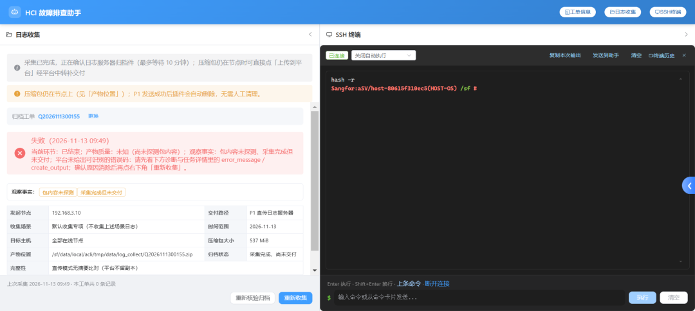
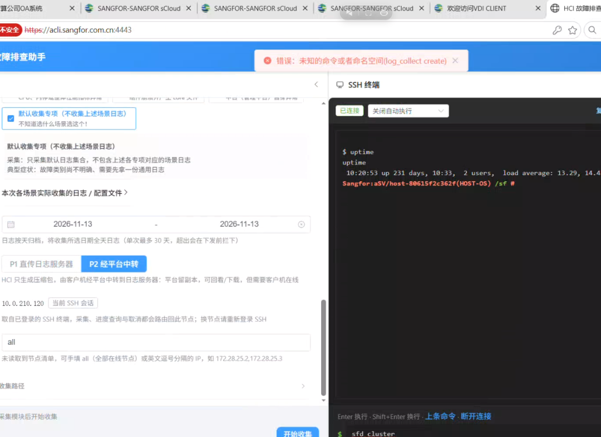
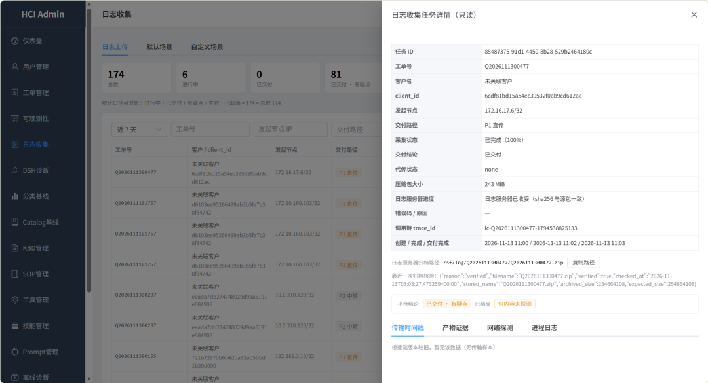
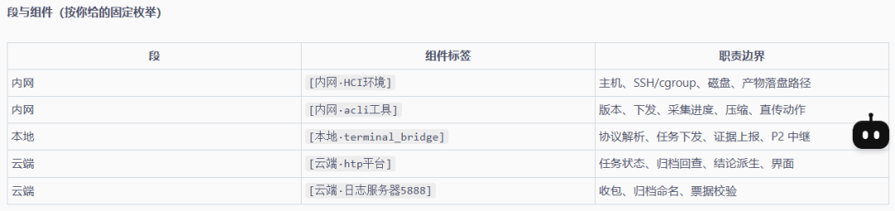
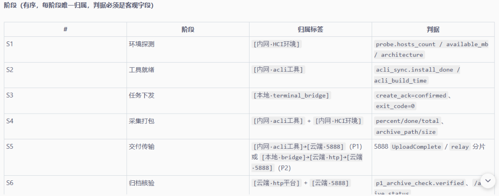
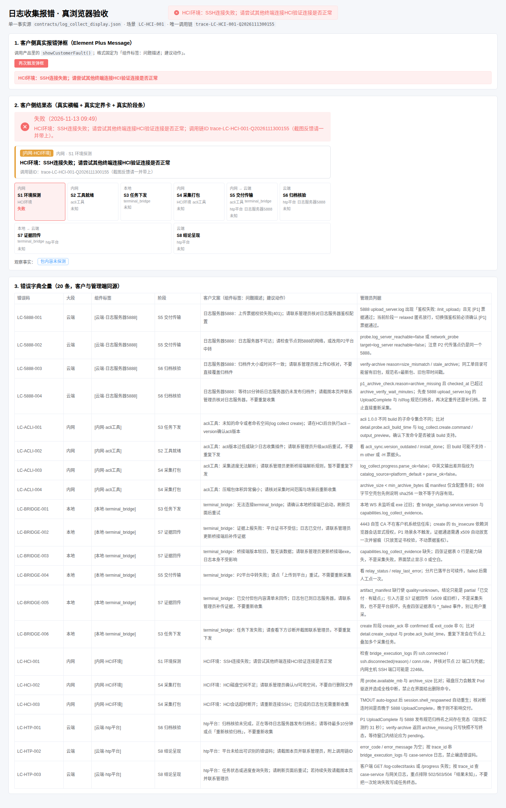
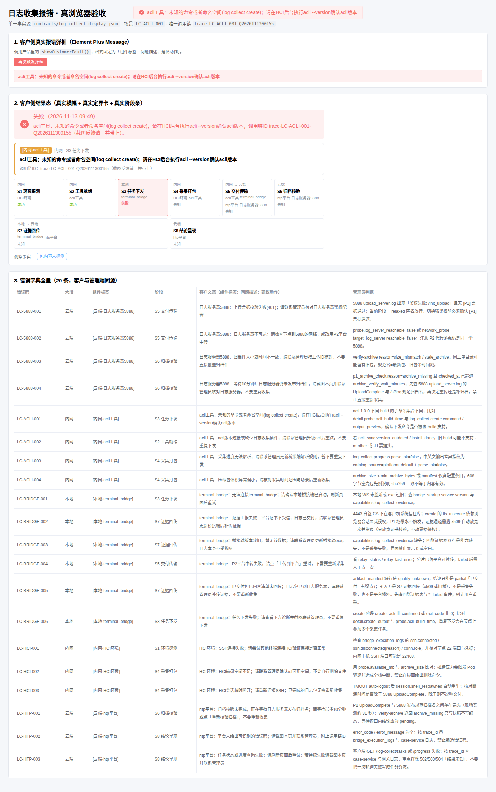
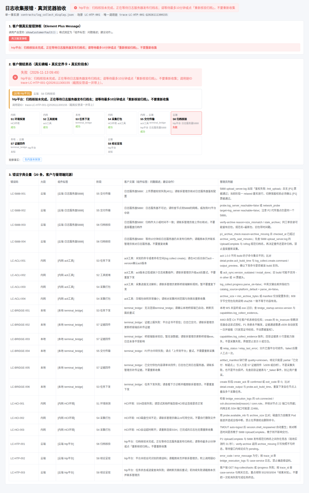
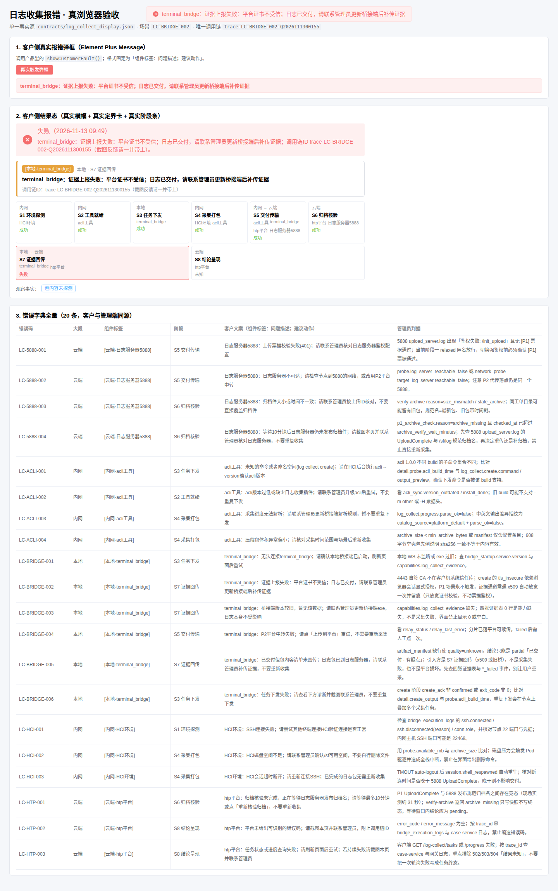
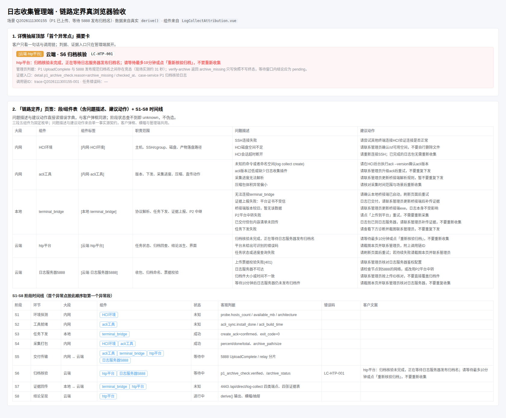

# 日志收集三段五组件定界与首个异常点归因

## 背景与触发

上线后第一个报错（工单 `Q2026111300155`）：客户界面显示「失败」，但同一任务的采集与 P1 直传都已成功，5888 侧两次 `UploadComplete`、平台 09:50:06 `verified=True`，两任务最终均为 `completed/100/delivered`。红框来自两个独立缺陷，而界面无法让人分辨是哪一层：



1. **等待态误报**：5888 `UploadComplete` 到发布规范归档名之间有约 31 秒窗口，一次 `archive_missing` 只是「结果未知」；后端 `derive()` 却把它当成「已结束但从未交付」写 `failed`。前端有 10 分钟有界等待，后端没有，两边口径不一致。
2. **证据回传受阻**：bridge → htp 的 4443 证据通道因 `x509: certificate signed by unknown authority` 全量失败，四张证据表 0 行，结论只能落到 `partial`「已交付 · 有疑点」。acli、HCI、5888 均无责。

客户反馈的核心问题不是「修 bug」，而是**看不懂报错属于谁**：「我一时也不清楚到底是 acli 工具收集日志有问题，还是 terminal_bridge 跟 HCI 的交互有问题，还是其他问题」。

另一类真实报错也没有定界能力，例如 acli 命令不支持时只有一个裸文本弹框：



管理端改造前只有四张证据页签，看不出问题落在哪一段、哪个组件：



## 用户原始材料归档

| 归档文件 | 内容 | 用途 |
|---|---|---|
| `assets/2026-11-13-段与组件枚举.png` | 三段五组件与职责边界 | 固定枚举的原始依据 |
| `assets/2026-11-13-阶段判据.png` | S1-S6 有序阶段与客观判据 | 阶段表原始依据（本次补齐 S7/S8） |
| `assets/2026-11-13-上线首错-客户界面.png` | 上线后第一个报错 | 触发本次改造的现场证据 |
| `assets/2026-11-13-acli命令未知-弹框.png` | `未知的命令或者命名空间(log_collect create)` | 弹框文案样例一 |
| `assets/2026-11-13-管理端详情-改造前.png` | 管理端详情抽屉四页签 | 改造前基线 |

原始枚举表与阶段表：





## 硬性约束

1. **三段固定**：内网 / 本地 / 云端，不新增第四段。
2. **五组件固定**：内网＝HCI环境、acli工具；本地＝terminal_bridge；云端＝htp平台、日志服务器5888。
3. **阶段有序**：S1-S8，首个异常点按 `stage_order` 取第一个 `failed/waiting` 段，结论本身不是异常点。
4. **判据必须客观**：只用 `probe.*`、`create_ack`、`exit_code`、`p1_archive_check.*`、`UploadComplete`、四张证据表等可查字段，禁止「平台没数据」＝「该环节失败」。
5. **客户弹框格式**：`[组件标签]：问题描述；建议动作`。示例：
   - `HCI环境：SSH连接失败；请尝试其他终端连接HCI验证连接是否正常`
   - `acli工具：未知的命令或者命名空间(log collect create)；请在HCI后台执行acli --version确认acli版本`
6. **单一事实源**：三段、组件、阶段、错误字典、文案格式只写进 `contracts/log_collect_display.json`，由 `scripts/gen_log_collect_display.py` 生成前后端常量与文案函数；客户横幅、阶段条、管理端四页签同源。
7. **呈现分层**：custom-ui 一句话定界、易截图反馈；admin-ui 全面专业，给出阶段、组件、判据、证据入口与调用链。

## 段与组件表（新增「问题描述」「建议动作」两列）

下表五列全部来自契约；问题描述与建议动作按组件聚合 `fault_catalog`，界面上的弹框、横幅与管理端表格读的是同一份数据。

| 段 | 组件标签 | 职责边界 | 问题描述 | 建议动作 |
|---|---|---|---|---|
| 内网 | `[内网·HCI环境]` | 主机、SSH/cgroup、磁盘、产物落盘路径 | SSH连接失败<br>HCI磁盘空间不足<br>HCI会话超时断开 | 请尝试其他终端连接HCI验证连接是否正常<br>请联系管理员确认/sf可用空间，不要自行删除文件<br>请重新连接SSH；已完成的日志包无需重新收集 |
| 内网 | `[内网·acli工具]` | 版本、下发、采集进度、压缩、直传动作 | 未知的命令或者命名空间(log collect create)<br>acli版本过低或缺少日志收集插件<br>采集进度无法解析<br>压缩包体积异常偏小 | 请在HCI后台执行acli --version确认acli版本<br>请联系管理员升级acli后重试，不要重复下发<br>请联系管理员更新桥接端解析规则，暂不要重复下发<br>请核对采集时间范围与场景后重新收集 |
| 本地 | `[本地·terminal_bridge]` | 协议解析、任务下发、证据上报、P2 中继 | 无法连接terminal_bridge<br>证据上报失败：平台证书不受信<br>桥接端版本较旧，暂无该数据<br>P2平台中转失败<br>已交付但包内容清单未回传<br>任务下发失败 | 请确认本地桥接端已启动，刷新页面后重试<br>日志已交付，请联系管理员更新桥接端后补传证据<br>请联系管理员更新桥接端exe，日志本身不受影响<br>请点「上传到平台」重试，不需要重新采集<br>日志包已到日志服务器，请联系管理员补传证据，不要重新收集<br>请查看下方诊断并截图联系管理员，不要重复下发 |
| 云端 | `[云端·htp平台]` | 任务状态、归档回查、结论派生、界面 | 归档核验未完成，正在等待日志服务器发布归档名<br>平台未给出可识别的错误码<br>任务状态或进度查询失败 | 请等待最多10分钟或点「重新核验归档」，不要重新收集<br>请截图本页并联系管理员，附上调用链ID<br>请刷新页面后重试；若持续失败请截图本页并联系管理员 |
| 云端 | `[云端·日志服务器5888]` | 收包、归档命名、票据校验 | 上传票据校验失败(401)<br>日志服务器不可达<br>归档件大小或时间不一致<br>等待10分钟后日志服务器仍未发布归档件 | 请联系管理员核对日志服务器鉴权配置<br>请检查节点到5888的网络，或改用P2平台中转<br>请联系管理员按上传ID核对，不要直接覆盖归档件<br>请截图本页并联系管理员核对日志服务器，不要重复收集 |

## 阶段表（S1-S8）

跨段阶段用 `scopes` 数组与 `scope_label` 表达，不再使用 `intranet_cloud` 这类非枚举值；前端可直接显示「内网 → 云端」「本地 → 云端」。

| # | 阶段 | 大段 | 归属标签 | 客观判据 |
|---|---|---|---|---|
| S1 | 环境探测 | 内网 | `[内网·HCI环境]` | `probe.hosts_count / available_mb / architecture` |
| S2 | 工具就绪 | 内网 | `[内网·acli工具]` | `acli_sync.install_done / acli_build_time` |
| S3 | 任务下发 | 本地 | `[本地·terminal_bridge]` | `create_ack=confirmed、exit_code=0` |
| S4 | 采集打包 | 内网 | `[内网·HCI环境]` + `[内网·acli工具]` | `percent/done/total、archive_path/size` |
| S5 | 交付传输 | 内网 → 云端 | `[内网·acli工具]` + `[本地·terminal_bridge]` + `[云端·htp平台]` + `[云端·日志服务器5888]` | `5888 UploadComplete / relay 分片` |
| S6 | 归档核验 | 云端 | `[云端·htp平台]` + `[云端·日志服务器5888]` | `p1_archive_check.verified、/archive_status` |
| S7 | 证据回传 | 本地 → 云端 | `[本地·terminal_bridge]` + `[云端·htp平台]` | `4443 /api/direct/log-collect` 四类端点、四张证据表 |
| S8 | 结论呈现 | 云端 | `[云端·htp平台]` | `derive()` 输出、横幅/抽屉 |

## 三处优化

### 1. 归档核验等待态不再写成失败

`derive()` 是唯一派生点。新增 `archive_verify_state(task, now)`：只有 `p1_archive_check.reason ∈ {archive_missing, archive_size_invalid}` 且 `checked_at` 落在 `ARCHIVE_VERIFY_WAIT_MINUTES=10` 分钟内、任务尚未 `delivered/cancelled/failed` 时，阶段为 `verifying`、结论 `pending`、观察事实「正在核验归档件」、合成进度显示「—」。

对抗性边界：`checked_at` 缺失或为未来时间一律不等待（防止任务被永久挂起）；等满 10 分钟仍查不到才落 `failed`，归因 `LC-5888-004` 到日志服务器；`verified=True` 后同一任务自动翻到 `settled` + 已交付结论。P1 直传平台不留副本、节点包自删，因此只要走到归档核验，体积缺失不再被写成「未取到有效日志」。

### 2. 证据通道 x509 自动放宽一次

`terminal_bridge/log_collect_evidence.go` 命中 `isUntrustedCertificateError` 时，按 `task_id` 记住放宽状态并写 `log_collect.evidence_tls_relaxed` 事件（含 `trace_id`、`reason`、作用域），随后对本次请求重建请求体重试一次。安全边界：只跳过证书校验，`X-Evidence-Ticket` 仍绑定 `task_id`；状态按 `task_id` 存内存、不落盘、不污染其它任务与交付通道；每次新下发先清除旧状态重新严格校验。

### 3. 三段五组件 × S1-S8 × 首个异常点

`derive()` 额外输出 `stages`（8 段，含段标签、组件、状态、判据、客户文案）与 `fault_attribution`（14 个 snake_case 字段，含 `customer_text`、`admin_detail`、`evidence`、`trace_id`）。错误归类取**最长命中关键词**而非首个命中，避免 `terminal_bridge`、`401`、`available_mb` 这类泛词抢走 x509、票据错误；`dict` 载荷只取 `error/message/reason/detail`，避免正常字段名被误当故障。

`LC-BRIDGE-005`（原 `LC-HTP-003`）从「平台」改归本地桥接端：包内容清单缺失的引入方是 S7 证据回传，不是平台损坏，也不是采集失败——这是「谁报错」与「谁引入」的分离。

## 呈现分层

| 界面 | 呈现 |
|---|---|
| custom-ui | 弹框统一为 `[组件标签]：问题描述；建议动作`；结果态横幅收敛成一句话 + 调用链ID；`LogCollectFaultCard.vue` 展示首个异常点标签与 S1-S8 阶段条（异常段高亮），方便整页截图反馈 |
| admin-ui | 详情抽屉在四张证据页签之外新增「链路定界」：首个异常点摘要（组件标签、段、阶段、错误码、客户文案、管理员判据、证据入口、`trace_id`）、段与组件表（含问题描述/建议动作）、S1-S8 阶段时间线；老后端未返回阶段时明确写「请升级 case-service」，不伪造状态 |

## 真浏览器验收

验收入口：`frontend/customer/verify/index.html`（仅 dev，不进生产构建），用 `?code=LC-XXXX-XXX` 切换场景。页面只挂载产品中真实使用的组件与函数：`buildResultHeadline()` 生成横幅、`LogCollectFaultCard.vue` 渲染定界卡与阶段条、`showCustomerFault()` 触发真实 Element Plus Message、`@hci/shared` 的 codegen 产物渲染全量错误字典。

执行命令：

```bash
cd frontend/customer && pnpm dev --port 3101
npx playwright screenshot --full-page --wait-for-timeout 1200 \
  --viewport-size "1440,1000" \
  "http://127.0.0.1:3101/verify/index.html?code=LC-HCI-001" \
  docs/solution/events/assets/2026-11-13-验收-LC-HCI-001.png
```

两张用户指定样例的真实页面效果：





上线首错对应的「核验中」与证据通道 x509：





全部 20 个错误码场景逐一张全页截图（每张都含该场景的真实弹框、横幅、定界卡、阶段条与全量字典表）：

| 段 | 错误码 | 截图 |
|---|---|---|
| 内网·HCI环境 | `LC-HCI-001` / `LC-HCI-002` / `LC-HCI-003` | [001](assets/2026-11-13-验收-LC-HCI-001.png) · [002](assets/2026-11-13-验收-LC-HCI-002.png) · [003](assets/2026-11-13-验收-LC-HCI-003.png) |
| 内网·acli工具 | `LC-ACLI-001` / `LC-ACLI-002` / `LC-ACLI-003` / `LC-ACLI-004` | [001](assets/2026-11-13-验收-LC-ACLI-001.png) · [002](assets/2026-11-13-验收-LC-ACLI-002.png) · [003](assets/2026-11-13-验收-LC-ACLI-003.png) · [004](assets/2026-11-13-验收-LC-ACLI-004.png) |
| 本地·terminal_bridge | `LC-BRIDGE-001` ~ `LC-BRIDGE-006` | [001](assets/2026-11-13-验收-LC-BRIDGE-001.png) · [002](assets/2026-11-13-验收-LC-BRIDGE-002.png) · [003](assets/2026-11-13-验收-LC-BRIDGE-003.png) · [004](assets/2026-11-13-验收-LC-BRIDGE-004.png) · [005](assets/2026-11-13-验收-LC-BRIDGE-005.png) · [006](assets/2026-11-13-验收-LC-BRIDGE-006.png) |
| 云端·htp平台 | `LC-HTP-001` / `LC-HTP-002` / `LC-HTP-003` | [001](assets/2026-11-13-验收-LC-HTP-001.png) · [002](assets/2026-11-13-验收-LC-HTP-002.png) · [003](assets/2026-11-13-验收-LC-HTP-003.png) |
| 云端·日志服务器5888 | `LC-5888-001` ~ `LC-5888-004` | [001](assets/2026-11-13-验收-LC-5888-001.png) · [002](assets/2026-11-13-验收-LC-5888-002.png) · [003](assets/2026-11-13-验收-LC-5888-003.png) · [004](assets/2026-11-13-验收-LC-5888-004.png) |

### 管理端「链路定界」

管理端的验收数据同样由真实 `derive()` 生成（`scripts/gen_log_collect_admin_verify_fixture.py` 调用 `derive()` 写 `frontend/admin/verify/mock-admin.json`，`--check` 可校验 fixture 未漂移），页面挂载产品里同一个 `LogCollectAttribution.vue`，因此截图证明的是产品逻辑而非手写 mock。

| 场景 | 证据 |
|---|---|
| `Q2026111300155` 等待 5888 发布归档名：摘要卡显示 `[云端·htp平台]` / `S6 归档核验` / `LC-HTP-001`，段/组件表含问题描述与建议动作两列，S1-S8 时间线 8 行 | `assets/2026-11-13-验收-管理端链路定界.png` |



```bash
cd frontend/admin && pnpm dev --port 3102
NODE_PATH=<npx playwright 的 node_modules> node frontend/admin/verify/capture.cjs
```

脚本会断言摘要卡 1 个、表格 2 个、阶段行 8 条与页面 JS 异常为 0，避免「截到一张空表」也被当成通过。

## 验收结果

| 门禁 | 结果 |
|---|---|
| 契约闭合 `validate_contract()` + `--check` | 通过（悬空错误码、前缀与责任组件不符、跨段非法 scope 均在 codegen 阶段拒绝） |
| case-service 单测 | 485 项通过（新增等待态、超窗、`delivered` 翻转、三段五组件、用户文案、泛词不抢归因、无删除命令） |
| `ruff check backend/` + 生成器 | 通过 |
| terminal_bridge | `go vet` / `go test -race ./...` / `gofmt -l` / `go build` 全通过（新增自签证书放宽、跨任务不污染、应用错误不误放宽用例） |
| customer-ui | `vue-tsc -b` + vite build 通过；vitest 55 文件 / 726 例通过 |
| admin-ui | `vue-tsc -b` + vite build 通过；vitest 23 文件 / 224 例通过 |
| 真浏览器 | Playwright 逐场景全页截图 20 张，真实 Element Plus 弹框、横幅、定界卡、阶段条、全量字典表均可见 |

## 关键文件

- `contracts/log_collect_display.json`（`schema_version: 2`）
- `scripts/gen_log_collect_display.py`、`backend/case-service/app/domain/log_collect_display_generated.py`、`frontend/shared/src/logCollectDisplay.ts`
- `backend/case-service/app/domain/log_collect_display.py`、`app/schemas/log_collect_display.py`
- `terminal_bridge/log_collect_evidence.go`、`terminal_bridge/log_collect_evidence_tls_test.go`
- `frontend/customer/src/utils/logCollectFault.ts`、`src/components/LogCollectFaultCard.vue`、`src/components/LogCollectPanel.vue`、`src/utils/logCollectDelivery.ts`
- `frontend/admin/src/views/components/LogUploadPanel.vue`、`src/api/logCollectAdminTasks.ts`
- `frontend/admin/src/views/components/LogCollectAttribution.vue`（摘要卡 + 段组件表 + 阶段时间线，详情抽屉与验收页共用）
- `frontend/customer/verify/`、`frontend/admin/verify/`（可回归的真浏览器验收入口）
- `scripts/gen_log_collect_admin_verify_fixture.py`（用真实 `derive()` 生成管理端验收数据）
